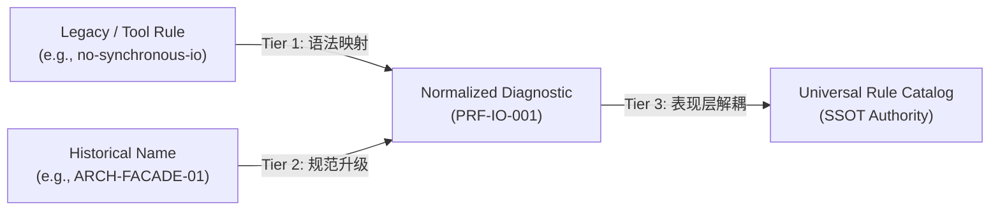
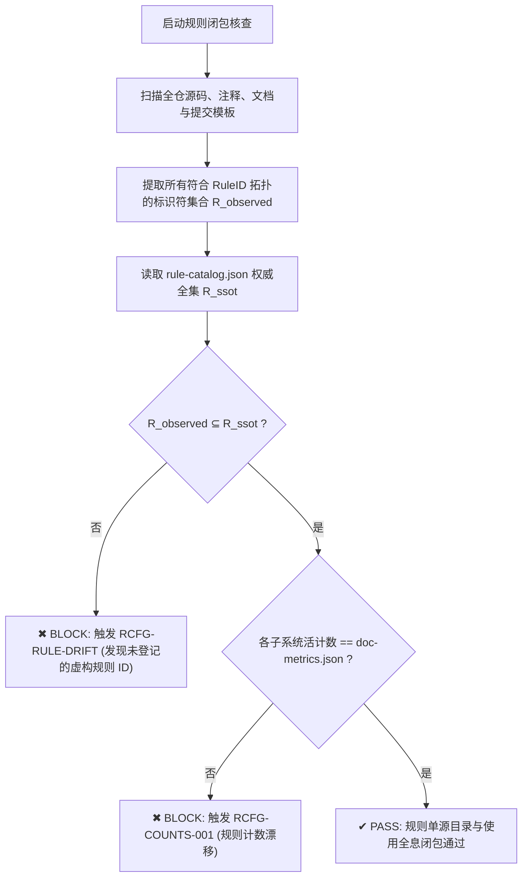

# 单源规则目录（SSOT）与元数据一致性架构规范

> 本文档为全工作区规则元治理、单源规则目录（Single Source of Truth, SSOT）及跨项目规则生命周期管理的权威架构设计与工程契约手册。

---

## 一、 规则元治理第一性原理与架构定位

全工作区包含多个异构技术栈系统（Rust 内核、TypeScript 分析引擎、VS Code 扩展、Godot 游戏逻辑），各系统均定义了大量静态分析检查、门禁拦截与架构约束。若缺乏统一的元数据治理，必然滋生：
1. **规则漂移（Rule Drift）**：同一架构约束在不同子系统具有不同命名、不同阈值或冲突的严重度定义；
2. **规则虚构（Rule Fabrication）**：提交信息、文档或代码注释中引用并不存在的“幽灵规则”，导致审查与可追溯性失效；
3. **元数据碎片化**：规则描述、修复指引与严重度散落于各代码文件，难以统一生成面向智能体与开发者的综合规约。

为此，工作区确立**单源规则目录（SSOT）总线**：
- **全域单源真源**：`scripts/common/rule-catalog.json` 为全工作区所有规则的唯一终极权威；
- **单向生成流**：所有文档、门禁检查器、SubAgent 规则手册与提交拦截器均由此单源真源派生，严禁任何逆向私有覆盖；
- **双向严格闭包**：全仓代码或注释中出现的每个规则标识符，必须 100% 存在于规则目录中（`RCFG-RULE-DRIFT`）；规则目录中的每条规则，必须具有明确的代码实现或引证映射（`RCFG-COUNTS-001`）。

---

## 二、 3-3-3 标准命名拓扑与权威词典

全工作区统一强制采用标准 **3-3-3（Domain-Category-Index）** 命名拓扑规范：

$$\text{RuleID} = \langle\text{Domain}\rangle\text{-}\langle\text{Category}\rangle\text{-}\langle\text{Number}\rangle$$

```
   ┌───────────────┐     ┌───────────────┐     ┌───────────────┐
   │ Domain (3~4B) │ ─── │ Category (3B) │ ─── │ Number (3D)   │
   │ 领域大类      │     │ 关注点分类    │     │ 序列号        │
   │ PRF / ARCH / …│     │ IO / FAC / …  │     │ 001, 002, …   │
   └───────────────┘     └───────────────┘     └───────────────┘
```

### 1. 权威三字母词典与语义约束

| 领域前缀 (Domain) | 语义覆盖范围 | 核心分类词素 (Category) | 典型关注点与一票否决项 |
| :--- | :--- | :--- | :--- |
| **`PRF-`** | 性能与算子效率 | `IO`, `ALG`, `MEM`, `CPU` | 禁关键路径同步 I/O (`PRF-IO-001`)、避免 $O(N^2)$ 遍历 (`PRF-ALG-002`) |
| **`ARCH-`** | 系统架构与分层边界 | `FAC`, `ABS`, `DEP`, `CYC` | 门面实质承载 (`ARCH-FAC-001`)、单行透传跳板清零 (`ARCH-ABS-001`) |
| **`CPX-`** | 复杂度与代码体积 | `CC`, `DEP`, `VOL`, `NEST` | 圈复杂度 $\text{CC} \le 15$ (`CPX-CC-001`)、嵌套深度 $\le 4$ (`CPX-NEST-001`) |
| **`SEC-`** | 代码安全与污点防护 | `KEY`, `EXP`, `SAN`, `DOS` | 敏感密钥拦截 (`SEC-KEY-001`)、前后端暴露面隔离 (`SEC-EXP-001`) |
| **`HYG-`** | 物理与工程卫生 | `EMP`, `EOL`, `BOM`, `CLN` | 零 0 字节文件 (`HYG-EMP-001`)、LF 换行契约 (`HYG-EOL-001`) |
| **`FGT-`** | 分形 Git 内核规范 | `LCK`, `PRF`, `SAF`, `POS` | 零并发锁争用 (`FGT-LCK-001`)、循环零堆分配 (`FGT-PRF-001`) |
| **`ADV-`** | 领域高级专精约束 | `PRF`, `AST`, `CFG`, `MOD` | WebGames 对象池零堆分配 (`ADV-PRF-002`)、状态机重置契约 |
| **`RCFG-`** | 规则元治理防御 | `CAT`, `DRIFT`, `META` | 规则 ID 闭包守卫 (`RCFG-RULE-DRIFT`)、规则计数单源 (`RCFG-COUNTS-001`) |

---

## 三、 三阶别名等价网络 (Alias Equivalence Network)

在架构演进过程中，部分历史规则或第三方分析工具（如 ESLint、Clippy、Oxc）发射的规则 ID 需要无缝映射至标准 3-3-3 命名体系。系统建立了**三阶别名等价网络**：



1. **一阶：工具原语映射（Tool Primitive Mapping）**：
   将语言级 linter 的原生字符串标识（如 `no-eval`, `radix`, `no-var`）规范化绑定到对应 3-3-3 规约；
2. **二阶：历史演进对齐（Historical Evolution Alignment）**：
   对早期未完全对齐 3-3-3 拓扑的历史代号建立严格双向别名索引表，确保旧有提交历史、日志记录与新规则体系 100% 互通；
3. **三阶：表现层聚合映射（Presentation Aggregation）**：
   在向人类开发者输出诊断报告时，将多条紧密相关的底层语法诊断合并为单一高阶架构治理项，降低认知负荷。

---

## 四、 跨项目规则分布与双向闭包契约

### 1. 规则总量单源分布矩阵

全工作区单源目录收录规则严格闭环为 <!-- METRICS:BEGIN rule-total -->**528 条规则**<!-- METRICS:END rule-total -->，分布于四大子系统：

| 子系统领域 | 规则承载模块 | 规则收录范围 | 核心审查职责 |
| :--- | :--- | :--- | :--- |
| **`auto-refactor`** | `src/core/rules/` | <!-- METRICS:BEGIN rule-auto-refactor -->**375 条规则**<!-- METRICS:END rule-auto-refactor --> | 静态分析重构、AST 局部切片守卫、十维质量评分、多语言现代化 |
| **`workspace-timing`** | `scripts/src/review/` | <!-- METRICS:BEGIN rule-workspace-timing -->**49 条规则**<!-- METRICS:END rule-workspace-timing --> | VS Code 扩展五层架构解耦、双写崩溃恢复、UI 双语与无障碍 |
| **`WebGames`** | `mod_sdk/docs/` | <!-- METRICS:BEGIN rule-webgames -->**50 条规则**<!-- METRICS:END rule-webgames --> | 卡拉尔配置驱动、视图单向快照注入、对象池零堆分配、异步排空 |
| **全局治理与脚本** | `scripts/common/` | **35 项**通用基础设施规则 | 物理卫生八维、双平台脚本同构、递归删除安全、门禁调用契约 |

### 2. 双向闭包判定算法



---

## 五、 底层诊断与表现层解耦架构

静态分析系统坚决分离**底层确定性诊断（Diagnostic Core）**与**表现层用户反馈（Presentation Layer）**：

1. **诊断核心（纯数据流，零副作用）**：
   - 输入：AST 节点、符号表索引、局部切片特征向量；
   - 输出：结构化违规项列表（包含绝对行号、字符偏移、精确度量值、理论上限与触发规则 ID）；
   - 契约：纯函数，确定性执行，不包含面向特定人类语言的硬编码提示语；
2. **表现层格式化器（Presentation Formatter）**：
   - 消费：结构化违规项列表 + 单源规则目录元数据字典；
   - 注入：国际化双语提示（zh-CN / en-US）、快速修复代码补丁（Codemod Hint）、文档权威引用；
   - 输出：Markdown 审查快照、彩色终端高亮输出或 LSP Diagnostics 协议包。

---

## 六、 自动化门禁脚本矩阵

全工作区通过多道自动化脚本看守规则单源目录的权威性：

| 门禁守卫脚本 | 触发阶段 | 执行逻辑与裁定契约 |
| :--- | :--- | :--- |
| `scripts/common/validate-rule-id-closure.js` | Pre-commit / Audit-all | 全量扫描全仓代码与注释，严防未登记规则 ID 进入主干（`RCFG-RULE-DRIFT`） |
| `scripts/common/generate-rule-catalog.js` | Pre-push / CI | 聚合各子系统规则定义，校验 JSON Schema 合规性，生成单源目录 |
| `scripts/common/validate-rule-source-consistency.js` | Audit-all | 比对各子系统规则源文件与全局 JSON 的哈希与属性对齐 |
| `scripts/common/validate-doc-reachability.js` | Pre-push / CI | 保证所有规约文档在导航拓扑中 100% 可达，零孤儿规约 |
