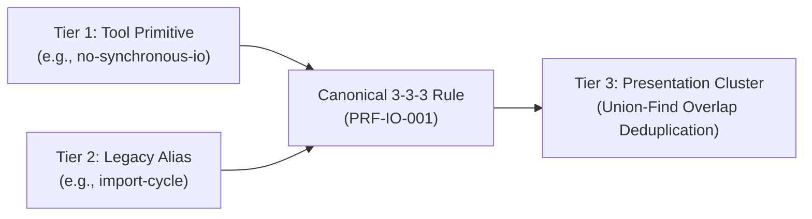
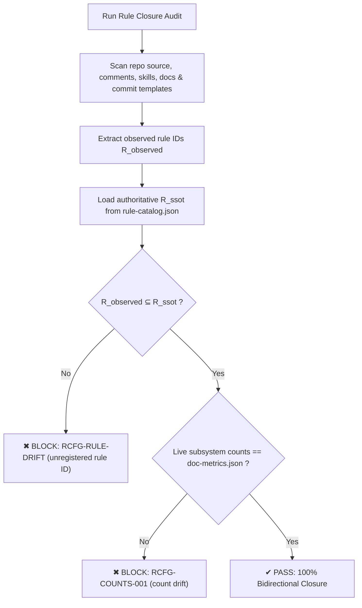

# Single-Source Rule Catalog (SSOT) & Meta-Governance Specification

> Authoritative specification for workspace rule meta-governance, the Single Source of Truth (`scripts/common/rule-catalog.json`), 3-3-3 naming topology, and cross-project bidirectional closure.

---

## 1. First Principles of Rule Meta-Governance

Across the workspace's heterogeneous stacks (Rust kernel, TypeScript analysis engine, VS Code extension, Godot 4 simulation), `scripts/common/rule-catalog.json` serves as the sole authoritative rule bus:
1. **Zero Rule Drift**: Prevents conflicting names, thresholds, or severities for the same architectural invariant across subsystems.
2. **Zero Rule Fabrication (`RCFG-RULE-DRIFT`)**: Every rule ID cited in code, comments, commit messages, or skills must exist in `rule-catalog.json`.
3. **Bidirectional Count Closure (`RCFG-COUNTS-001`)**: Every catalog entry maps to a concrete rule source (`auto-refactor`, `workspace-timing`, `WebGames`, `fractal-git`, or `global-tooling`), and all rendered documentation counts derive from `rule-catalog.json`.

---

## 2. 3-3-3 Canonical Naming Topology

Canonical rule identifiers follow the **3-3-3 (`Domain-Category-Index`)** grammar:

$$\text{RuleID} = \langle\text{Domain}\rangle\text{-}\langle\text{Category}\rangle\text{-}\langle\text{Number}\rangle$$

| Domain Prefix | Semantic Scope | Core Categories | Representative Invariants |
| :--- | :--- | :--- | :--- |
| **`PRF-`** | Performance & Operator Efficiency | `IO`, `ALG`, `MEM`, `CPU` | No hot-path sync I/O (`PRF-IO-001`), avoid $O(N^2)$ nested scans (`PRF-ALG-002`) |
| **`ARCH-`** | Architecture & Layer Boundaries | `FAC`, `ABS`, `DEP`, `CYC` | Substantive facade (`ARCH-FAC-001`), zero $\le 3$-line trampolines (`ARCH-ABS-001`) |
| **`CPX-`** | Complexity & Code Volume | `CC`, `DEP`, `VOL`, `NEST` | Cognitive complexity $\text{CC} \le 15$ (`CPX-CC-001`), nesting depth $\le 4$ (`CPX-NEST-001`) |
| **`SEC-`** | Security & Taint Defense | `KEY`, `EXP`, `SAN`, `DOS` | Secret token interception (`SEC-KEY-001`), client exposure isolation (`SEC-EXP-001`) |
| **`HYG-`** | Physical & Repository Hygiene | `EMP`, `EOL`, `BOM`, `CLN` | Zero 0-byte files (`HYG-EMP-001`), strict LF/CRLF contract (`HYG-EOL-001`) |
| **`FGT-`** | Fractal Git Kernel Contracts | `LCK`, `PRF`, `SAF`, `POS` | Lock-free CAS (`FGT-LCK-001`), zero loop heap allocation (`FGT-PRF-001`) |
| **`ADV-`** | Advanced Domain Contracts | `PRF`, `AST`, `CFG`, `MOD` | WebGames object-pool zero allocation (`ADV-PRF-002`), state reset discipline |
| **`RCFG-`** | Rule Meta-Governance | `CAT`, `DRIFT`, `META` | Rule ID closure (`RCFG-RULE-DRIFT`), SSOT count parity (`RCFG-COUNTS-001`) |

---

## 3. Three-Tier Alias Equivalence Network

1. **Tier 1 (Tool Primitive Mapping)**: Maps native linter identifiers (`no-eval`, `radix`, `no-var`) to canonical 3-3-3 rules.
2. **Tier 2 (Legacy Evolution Alignment)**: Maps <!-- METRICS:BEGIN rule-auto-refactor-legacy -->**15 条**<!-- METRICS:END rule-auto-refactor-legacy --> historical rule aliases (`import-cycle`, `clean-layer-violation`, etc.) to planned 3-3-3 canonical counterparts (`ALIAS_MIGRATION_WINDOW`).
3. **Tier 3 (Presentation Clustering)**: Deduplicates overlapping diagnostics across <!-- METRICS:BEGIN overlap-cluster-count -->**11 个**<!-- METRICS:END overlap-cluster-count --> semantic clusters (covering <!-- METRICS:BEGIN overlap-member-count -->**23 条**<!-- METRICS:END overlap-member-count --> member rules) in the presentation adapter without altering raw AST emissions.

---

## 4. Cross-Project Rule Distribution & Bidirectional Closure

### 4.1 Single-Source Rule Distribution Matrix

`scripts/common/rule-catalog.json` governs <!-- METRICS:BEGIN rule-total -->**534 条规则**<!-- METRICS:END rule-total --> across five controlled scopes:

| Scope | Source Location | Rule Count | Primary Governance Responsibility |
| :--- | :--- | :--- | :--- |
| **`auto-refactor`** | `auto-refactor/src/core/rules/registry.ts` | <!-- METRICS:BEGIN rule-auto-refactor -->**375 条规则**<!-- METRICS:END rule-auto-refactor --> | 32-expert Sparse MoE static analysis, AST slice guards, 10D scoring, 5-language modernization |
| **`workspace-timing`** | `workspace-timing/scripts/src/review/` | <!-- METRICS:BEGIN rule-workspace-timing -->**49 条规则**<!-- METRICS:END rule-workspace-timing --> | VS Code extension 5-layer decoupling, RingBuffer+Journal crash recovery, bilingual UI & a11y |
| **`WebGames`** | `scripts/common/rule-sources/webgames-rules.json` | <!-- METRICS:BEGIN rule-webgames -->**50 条规则**<!-- METRICS:END rule-webgames --> | Kalar `GameConfig` SSOT, unidirectional `apply_snapshot` views, object-pool zero loop allocation |
| **`fractal-git`** | `fractal-git/crates/fg-gate/` | <!-- METRICS:BEGIN rule-fractal-git -->**37 条规则**<!-- METRICS:END rule-fractal-git --> | 10-crate kernel boundaries, lock-free CAS, zero panic, `// SAFETY:` invariants & poset integrity |
| **`global-tooling`** | `scripts/common/rule-sources/global-rules.json` | <!-- METRICS:BEGIN rule-global-tooling -->**23 条规则**<!-- METRICS:END rule-global-tooling --> | 8D physical hygiene, cross-platform script isomorphism, destructive-op taint guards, commit gates |

### 4.2 Bidirectional Closure Verification

---

## 5. Diagnostic Core vs. Presentation Decoupling

1. **Diagnostic Core (Pure, Deterministic)**: Consumes AST nodes, symbol tables, and `LineFeatureTape`; emits raw structured `Issue` records (`rule`, `line`, `column`, metric values) without locale-dependent prose.
2. **Presentation Layer (`PraxisPresentationAdapter` / `AASReporter`)**: Enriches raw issues with bilingual catalog templates (`DIAGNOSTIC_CATALOG`), union-find overlap deduplication, and `L1`–`L5` topological sorting.

---

## 6. Automated Gate Scripts

| Script | Stage | Contract |
| :--- | :--- | :--- |
| `scripts/common/validate-rule-id-closure.js` | Pre-commit / Audit-all | Blocks any unregistered rule ID across code, scripts, and skills (`RCFG-RULE-DRIFT`) |
| `scripts/common/generate-rule-catalog.js` | Pre-push / CI | Verifies rule source parity against `scripts/common/rule-catalog.json` (`--write` regenerates) |
| `scripts/common/validate-scoring-rule-closure.js` | Pre-push / CI | Verifies 100% of SSOT rules map to one of the 10 scoring dimensions |
| `scripts/common/validate-doc-reachability.js` | Pre-push / CI | Verifies 100% inbound link reachability across normative documentation |
