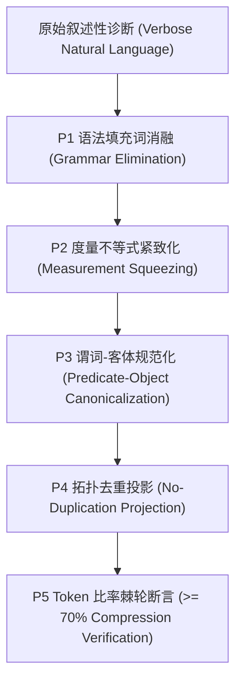

# 高效 Token 句子压缩与诊断消息标准化规范 (Token-Frugal Sentence & Diagnostic Specification)

> **规范编号**：`SPECIFICATION_TOKEN_FRUGAL_DIAGNOSTIC`  
> **适用范围**：全工作区智能体审查交互、AAS v1.0 序列化、静态分析器诊断生成及提交说明门禁  
> **关联真源**：[AGENTS.md](../../AGENTS.md) 「全工作区统一审查」行中的 AAS v1.0 与 Token 削减契约、[aas-reporter.ts](../../auto-refactor/src/core/reporting/aas-reporter.ts)、[diagnostic-catalog.ts](../../auto-refactor/src/core/rules/diagnostic-catalog.ts)

---

## 一、 核心目标与 Token 节约公理

在 Agent-Native 开发体系中，智能体（LLM Agent）在上下文窗口中解析海量诊断报告、静态分析输出与提交元数据。传统叙述性自然语言（如 `"Identifier 'LOOP_HEADER_RE' contains unapproved truncated abbreviation 'RE'."`）充斥大量低信息密度的语法填充词与路径复述，导致数十兆上下文浪费并稀释智能体注意力。

依据 `AGENTS.md` 刚性公理：
> **审查报告与 Token 节约**：严禁无压缩倾倒数兆原始 JSON；审查交互与报告交割强制遵循 AAS v1.0（文件聚类、L1~L5 拓扑排序、锚点内联）；**Token 削减率必须 $\ge 70\%$**。

本规范确立了诊断消息的**五维压缩协议**、**规范命名缩写边界**及**中心化模板字典标准**。

---

## 二、 高效 Token 句子五维压缩协议 (Five-Principle Compression Protocol)



### 1. P1: 语法填充词消融 (Grammar Elimination)
消融对逻辑判断零价值的客套语、被动态语素与修饰短语：
- 剔除 `contains unapproved truncated` $\to$ 压缩为 `has unapproved` 或 `unapproved`；
- 剔除 `is too short (< N characters); lacks semantic description` $\to$ 压缩为 `too short (< N chars); lacks semantic action`；
- 剔除 `consider simplifying or decomposing` $\to$ 压缩为 `simplify or decompose`；
- 剔除 `is vague and uninformative; lacks domain context` $\to$ 压缩为 `vague identifier lacks domain context`。

### 2. P2: 度量不等式紧致化 (Measurement Squeezing)
将度量超标的散文叙述转换为确定性的数学紧致关系：
- 冗余散文：`Cognitive complexity (19) exceeds threshold (15) in function 'dispatchCommand'`
- 压缩格式：`CC 19 > 15 in 'dispatchCommand'`
- 冗余散文：`Effective code volume of 1050 lines exceeds budget of 900 lines`
- 压缩格式：`ELOC 1050 > 900 budget`
- 冗余散文：`Token density 1.8 falls below minimum threshold 2.5`
- 压缩格式：`tau 1.8 < 2.5 floor`

### 3. P3: 谓词-客体规范化 (Predicate-Object Canonicalization)
统一修复建议（Suggestion/Remediation）的句式拓扑，恒定遵循：
$$\text{Sentence} = \langle\text{ImperativeVerb}\rangle\ \langle\text{Subject}\rangle\ [\to\ \langle\text{Target}\rangle]\ [\text{Rationale}]$$
- 示例：`Expand 'sf' -> 'sourceFile'`（取代 `Please expand the abbreviated token 'sf' into the full English word 'sourceFile'`）；
- 示例：`Decompose into submodules (ELOC <= 900)`（取代 `Consider splitting this file into smaller cohesive modules to satisfy the effective line limit`）。

### 4. P4: 拓扑去重投影 (No-Duplication Projection)
在 AAS 报告中，文件路径、规则家族、验证命令与工具名称强制按拓扑聚类一次性声明，**严禁在每一个 Finding 内部重复拷贝文件路径与环境指令**。

### 5. P5: Token 比率棘轮断言 (Compression Ratchet)
在压缩模式下，AAS 紧凑 JSON/Markdown 的字节体积与 Token 消耗相比于原始扁平 ScanReport 必须满足：
$$\text{ReductionRatio} = 1 - \frac{\text{AAS\_Tokens}}{\text{Raw\_Tokens}} \ge 70\%$$

---

## 三、 变量名优化与行业标准缩写边界 (Naming & Abbreviation Matrix)

`NAM-ABR-001` 与 `NAM-VAG-001` 是代码可读性与标准化的核心看守，但必须严格区分**晦涩无意义截断缩写**与**计算机科学行业标准领域语素**，杜绝误报导致的技术债扭曲：

| 类别 | 判定标准 | 典型正例（合规准入） | 典型反例（阻断重构） |
| :--- | :--- | :--- | :--- |
| **标准生态前缀/模块** | 语言标准库或生态固定约定 | `fs` (Node.js 文件系统), `db` (数据库句柄), `ast` (抽象语法树), `id` (标识符) | `usr` (应为 `user`), `btn` (应为 `button`), `tbl` (应为 `table`), `cnt` (应为 `count`) |
| **编译与正则约定** | 正则常数后缀、命令与AST算子 | `_RE` (正则常量后缀), `cmd` (命令字符串), `op` (AST算子), `prop` (对象属性) | `chk` (应为 `check`), `mgr` (应为 `manager`), `auth_mgr` (应为 `authManager`) |
| **形参与入参规范** | 函数形参及参数对象 | `param` (参数对象), `arg` / `args` (入参数组/CLI入参) | `ptr` (无裸指针语义却滥用), `sf` (自创缩写，应为 `sourceFile`) |
| **语义多义性阻断** | 含义模糊产生歧义的截断词 | 明确上下文：`cursorPosition`, `currentEntry` | 裸多义词：`cur`, `res` (分不清 result 还是 response), `sec` (分不清 second 还是 security) |
| **模糊泛化裸词阻断** | 缺乏任何领域修饰的无信息裸词 | 具名领域词：`parseResult`, `ruleItem`, `tokenPayload` | 裸泛化词：`data`, `item`, `res`, `ret`, `tmp`, `val`, `obj` (`NAM-VAG-001`) |

---

## 四、 诊断消息中心化模板字典规范 (`DIAGNOSTIC_CATALOG`)

依据 `GOV-MSG-001`，所有底层诊断字符串必须收口至单源只读字典，严禁在分析器发射点硬编码内联字符串散文。模板格式定义如下：

```typescript
export interface DiagnosticTemplate {
    readonly ruleId: string;
    readonly defaultSeverity: Severity;
    readonly actionCode: string;       // AR:<DOMAIN>:<ID>
    readonly defaultMessage: string;   // Token-Frugal compressed diagnostic
    readonly suggestion: string;       // Imperative remediation clause (<= 80 chars)
}
```

### 核心规则族标准模板对照表：

| 规则族 | 规则 ID | 规范压缩消息 (`defaultMessage`) | 规范修复建议 (`suggestion`) |
| :--- | :--- | :--- | :--- |
| **NAM** | `NAM-VAG-001` | `Vague identifier lacks domain context.` | `Rename to domain-qualified identifier (e.g. parseResult, tokenPayload).` |
| **NAM** | `NAM-ABR-001` | `Identifier has unapproved truncated abbreviation.` | `Expand unapproved abbreviation into standard domain term.` |
| **NAM** | `NAM-LEN-001` | `Variable identifier length outside acceptable bounds.` | `Rename to expressive identifier between 3 and 40 characters.` |
| **NAM** | `NAM-LEN-002` | `Function identifier lacks semantic verb-noun action.` | `Rename to descriptive verb-noun phrase.` |
| **CPX** | `CPX-BUD-001` | `Cognitive complexity budget exceeded.` | `Decompose complex branches and extract guard clauses.` |
| **CPX** | `CPX-NEST-001` | `Control flow nesting depth exceeds 4.` | `Flatten nested logic using early returns and guard clauses.` |
| **SIM** | `SIM-ARGS-001` | `Parameter list exceeds 3 positional arguments.` | `Consolidate parameters into a read-only parameter object.` |
| **SIM** | `SIM-LONG-001` | `Procedure line count exceeds single-responsibility limit.` | `Extract focused sub-procedures to isolate responsibilities.` |
| **VOL** | `VOL-ELOC-001` | `Effective code volume budget exceeded.` | `Decompose into cohesive submodules (ELOC <= 900).` |
| **VOL** | `VOL-DIL-001` | `Token density below floor threshold.` | `Inline thin boilerplate or remove single-token vertical sprawl.` |
