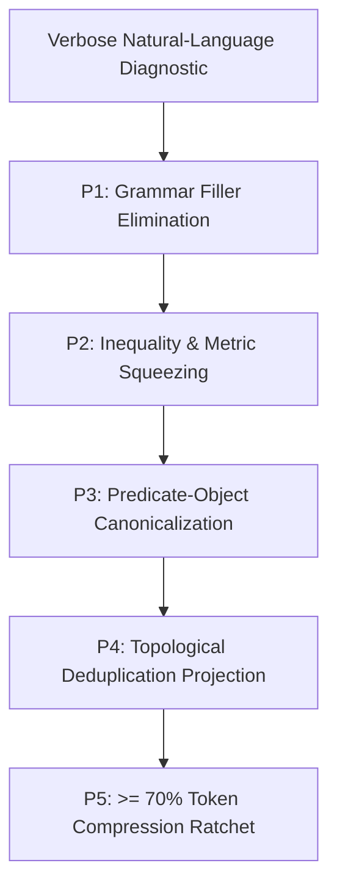

# Token-Frugal Sentence & Diagnostic Specification

> **Spec ID**: `SPECIFICATION_TOKEN_FRUGAL_DIAGNOSTIC`  
> **Scope**: Agent review interactions, AAS v1.0 serialization, static analyzer diagnostic templates, and commit message gates  
> **Source of Truth**: [AGENTS.md](../../AGENTS.md) 「全工作区统一审查」行, [aas-reporter.ts](../../auto-refactor/src/core/reporting/aas-reporter.ts), [diagnostic-catalog.ts](../../auto-refactor/src/core/rules/diagnostic-catalog.ts)

---

## 1. Core Objective & Token Compression Axiom

Per `AGENTS.md`:
> **Agent Review & Token Frugal Axiom**: Never dump uncompressed multi-megabyte raw JSON; all review reports follow AAS v1.0 (`L1_CONTRACT` $\to$ `L5_GOVERNANCE` topological & file aggregation with inline code anchors), achieving **$\ge 70\%$ token reduction**.

---

## 2. Five-Principle Compression Protocol (`P1`–`P5`)



1. **P1 (Grammar Filler Elimination)**: Strip low-entropy filler (`contains unapproved truncated` $\to$ `has unapproved`; `consider simplifying or decomposing` $\to$ `simplify or decompose`).
2. **P2 (Inequality & Metric Squeezing)**: Replace prose metric descriptions with compact symbolic inequalities:
   - `CC 19 > 15 in 'dispatchCommand'` (replaces `Cognitive complexity (19) exceeds threshold (15) in function 'dispatchCommand'`)
   - `ELOC 1050 > 900 budget` (replaces `Effective code volume of 1050 lines exceeds budget of 900 lines`)
   - `tau 1.8 < 2.5 floor` (replaces `Token density 1.8 falls below minimum threshold 2.5`)
3. **P3 (Predicate-Object Canonicalization)**: Format remediation clauses as $\langle\text{ImperativeVerb}\rangle\ \langle\text{Subject}\rangle\ [\to\ \langle\text{Target}\rangle]\ [\text{Rationale}]$ (e.g., `Expand 'sf' -> 'sourceFile'`; `Decompose into submodules (ELOC <= 900)`).
4. **P4 (Topological Deduplication Projection)**: Group findings by file path, rule family, and architectural layer (`L1`–`L5`) once per cluster; never repeat file paths or verification commands inside individual finding items.
5. **P5 (Compression Ratchet)**:
   $$\text{ReductionRatio} = 1 - \frac{\text{AAS\_Tokens}}{\text{Raw\_Tokens}} \ge 70\%$$

---

## 3. Identifier Naming & CS Abbreviation Matrix (`NAM-ABR-001` / `NAM-VAG-001`)

| Category | Criterion | Approved (Compliant) | Blocked (Requires Refactoring) |
| :--- | :--- | :--- | :--- |
| **Standard Ecosystem / Stdlib** | Canonical language/runtime terms | `fs`, `db`, `ast`, `id`, `io`, `os`, `ui`, `ip`, `url`, `uri`, `jwt`, `sql`, `dom`, `api`, `cli`, `sdk`, `ipc`, `cas`, `wal`, `lru`, `rng`, `cfg`, `dfg`, `ssa` | `usr` (`user`), `btn` (`button`), `tbl` (`table`), `cnt` (`count`) |
| **Compiler & Regex Conventions** | Regex suffixes, commands, AST ops | `_RE`, `cmd`, `op`, `prop`, `fn`, `ctx`, `err`, `req`, `res` (HTTP handler only), `env`, `dir`, `ext`, `idx`, `len`, `min`, `max`, `num`, `str`, `buf`, `src`, `dst` | `chk` (`check`), `mgr` (`manager`), `auth_mgr` (`authManager`) |
| **Parameters & Arguments** | Function parameters & CLI args | `param`, `arg`, `args`, `opts`, `cfg`, `cb`, ` doc` | `ptr` (without raw pointer semantics), `sf` (`sourceFile`) |
| **Ambiguous Truncations** | Polysemous abbreviations | Qualified: `cursorPosition`, `currentEntry` | Bare: `cur`, `sec` (second vs security) |
| **Vague Bare Nouns (`NAM-VAG-001`)** | Unqualified generic placeholders | Domain-qualified: `parseResult`, `ruleItem`, `tokenPayload` | Bare: `data`, `item`, `ret`, `tmp`, `val`, `obj`, `info`, `stuff`, `temp` |

---

## 4. Centralized Diagnostic Catalog (`DIAGNOSTIC_CATALOG`)

Per `GOV-MSG-001`, all diagnostic strings reside in [`auto-refactor/src/core/rules/diagnostic-catalog.ts`](../../auto-refactor/src/core/rules/diagnostic-catalog.ts):

```typescript
export interface DiagnosticTemplate {
    readonly ruleId: string;
    readonly defaultSeverity: Severity;
    readonly actionCode: string;       // AR:<DOMAIN>:<ID>
    readonly defaultMessage: string;   // Token-frugal compressed diagnostic
    readonly suggestion: string;       // Imperative remediation clause (<= 80 chars)
}
```

| Family | Rule ID | `defaultMessage` | `suggestion` |
| :--- | :--- | :--- | :--- |
| **NAM** | `NAM-VAG-001` | `Vague identifier lacks domain context.` | `Rename to domain-qualified identifier (e.g. parseResult, tokenPayload).` |
| **NAM** | `NAM-ABR-001` | `Identifier has unapproved truncated abbreviation.` | `Expand unapproved abbreviation into standard domain term.` |
| **NAM** | `NAM-LEN-001` | `Variable identifier length outside acceptable bounds.` | `Rename to expressive identifier between 3 and 40 characters.` |
| **NAM** | `NAM-LEN-002` | `Function identifier lacks semantic verb-noun action.` | `Rename to descriptive verb-noun phrase.` |
| **CPX** | `CPX-BUD-001` | `Cognitive complexity budget exceeded.` | `Decompose complex branches and extract guard clauses.` |
| **CPX** | `CPX-NEST-001` | `Control flow nesting depth exceeds 4.` | `Flatten nested logic using early returns and guard clauses.` |
| **SIM** | `SIM-ARGS-001` | `Parameter list exceeds 3 positional arguments.` | `Consolidate parameters into a read-only parameter object.` |
| **SIM** | `SIM-LONG-001` | `Procedure line count exceeds single-responsibility limit.` | `Extract focused sub-procedures to isolate responsibilities.` |
| **VOL** | `VOL-ELOC-001` | `Effective code volume budget exceeded.` | `Decompose into cohesive submodules (ELOC <= 900).` |
| **VOL** | `VOL-DIL-001` | `Token density below floor threshold.` | `Inline thin boilerplate or remove single-token vertical sprawl.` |
