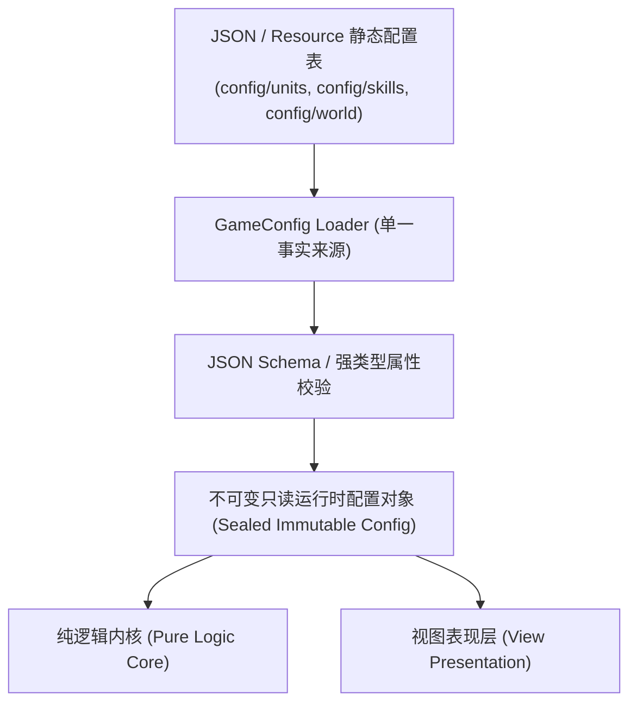
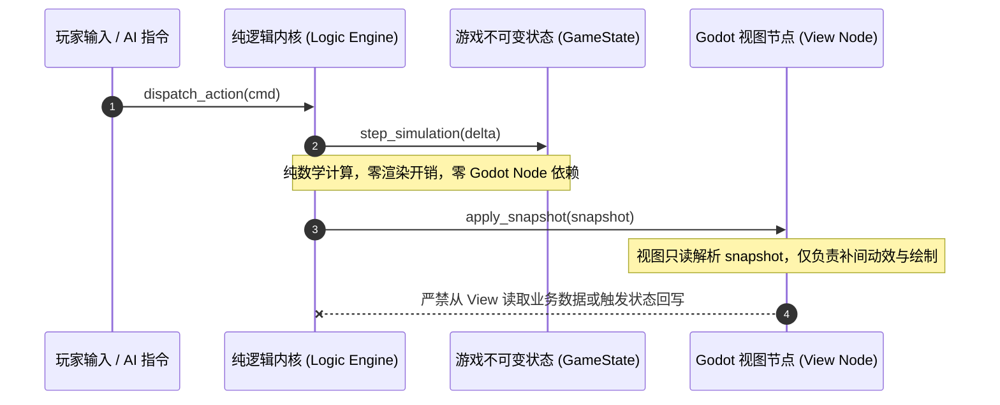
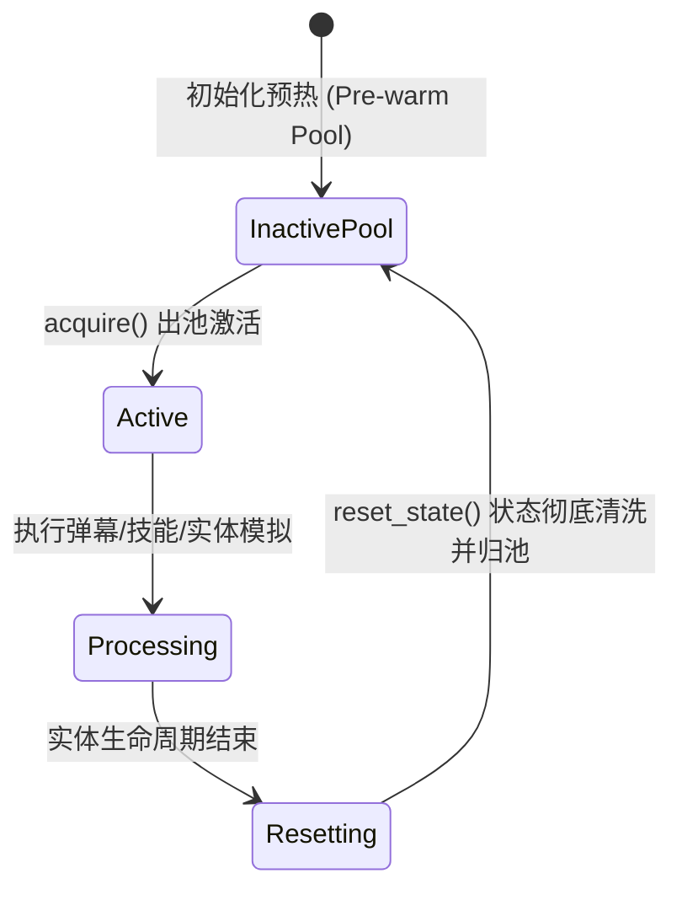
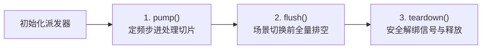

# WebGames 游戏系统架构、全域配置驱动与纯逻辑解耦规范

> 本文档为 `WebGames`（卡拉尔游戏世界）基于 Godot 4 引擎纯逻辑解耦、全域 `GameConfig` 驱动、对象池零瞬态堆分配与四阶段施工方案的系统级规范手册。

---

## 一、 系统定位与架构挑战

`WebGames` 是一个高并发、多实体驱动的沙盒策略与实时模拟游戏系统。在基于 Godot 4 的大型游戏工程中，传统开发模式极易落入如下陷阱：
1. **表现层与逻辑缠绕**：节点树（Node / Sprite2D）直接承载伤害计算、路径规划与状态结算，导致无法进行无头（Headless）离线快速测试；
2. **硬编码数值漫延**：游戏数值散落于 GDScript 代码中，修改配置牵一发动全身，破坏平衡性微调；
3. **高频 GC 垃圾回收卡顿**：每帧循环内产生瞬态对象分配（如 `Vector2`、临时字典、瞬态事件），触发底层垃圾回收器引发掉帧卡顿；
4. **异步事件挂起与内存泄露**：信号监听未成对解绑，场景切换时后台挂起未排空的异步协程。

为此，系统确立**全域配置单源驱动**、**视图表现层单向快照注入**与**对象池循环零瞬态堆分配**三大基石。

---

## 二、 全域 GameConfig 单源驱动体系

系统严禁在 GDScript 逻辑脚本中硬编码任何业务数值、掉落率、技能系数或初始属性，所有游戏实体与规则必须由 `GameConfig` 单源加载：

### 1. 配置规约与不变量
- **文件命名契约**：配置目录下的数据文件强制采用 `snake_case` 命名风格（如 `unit_attributes.json`, `combat_curves.json`）；
- **只读不可变性**：在游戏初始化阶段统一载入并冻结，运行期间严禁逻辑系统对配置对象执行动态原地写操作；
- **配置自闭包验证**：静态门禁 `DOMAIN-AUDIT-04` 严格校验实体引用完整性（如单位配置中声明的技能 ID 必须 100% 存在于技能配置表中）。

---

## 三、 纯逻辑内核与视图表现层单向快照解耦

系统严格遵循**数据计算驱动视图，视图绝不反向污染逻辑**的单向流动拓扑：

### 1. 纯逻辑内核（Pure Logic Core）
- **无头运行能力（Headless-Ready）**：可在不挂载任何可视节点、不启动显卡上下文的情况下纯命令行极速跑完 10,000 回合仿真与蒙特卡洛对战；
- **状态快照（State Snapshot）**：逻辑引擎每物理帧产生轻量不可变状态快照（只包含实体 ID、位置、血量百分比、动作枚举），作为通信的唯一介质。

### 2. 视图表现层（View Presentation）
- **单向快照注入契约（`apply_snapshot`）**：
  视图节点必须实现 `apply_snapshot(snapshot: Dictionary) -> void` 接口；
- **零业务计算公理**：视图严禁执行伤害计算、合法性校验或胜负判定；
- **动效平滑插值**：视图通过二阶阻尼谐振或 Lerp 算子平滑连接两帧快照间的物理坐标，实现渲染帧率与物理模拟频率解耦。

---

## 四、 对象池与循环零瞬态堆分配规范 (`ADV-PRF-002`)

在实时战斗与高频弹幕循环中，频繁分配与销毁对象是导致 Godot 卡顿的第一杀手：

### 1. 刚性约束指标 (`ADV-PRF-002`)
- **循环内零 `new()`**：在 `_physics_process(delta)`、`_process(delta)` 以及高频事件分发内，**严禁**出现任何堆分配调用（禁止实例化新节点、禁止动态 `dict = {}` 或创建新数组）；
- **预热与配额管理**：对象池在场景加载时完成静态配额预热，运行时通过 `acquire()` 复用闲置槽位；
- **状态彻底复位契约（`reset_state`）**：归池前必须显式调用 `reset_state()`，清空内部临时累加器、阻尼参数与缓动状态，杜绝前序生命周期的“幽灵脏数据”污染下一次复用。

---

## 五、 异步派发器三阶段生命周期契约

针对网络同步与延迟事件派发，系统强制遵循对称生命周期律：

1. **`pump()` 阶段**：每一逻辑帧按有界配额消费队列中的异步事件，防止单帧事件爆炸导致阻塞；
2. **`flush()` 阶段**：在场景迁移、关卡重置或关机退出前，必须显式调用 `flush()` 强制排空所有未决事务；
3. **`teardown()` 阶段**：成对解绑所有底层 Signal 监听器，清空闭包引用，杜绝孤儿回调引发的内存泄露。

---

## 六、 四阶段方案立项与工程交付纪律

WebGames 的所有功能开发与重大重构必须遵循严格的四阶段方案推进流程（`WebGames/docs/路线图/`）：

| 阶段 | 交付物案卷 | 核心审查与阻断标准 |
| :--- | :--- | :--- |
| **阶段 1** | `阶段1_上下文分析与影响面评估.md` | 明确需求背景、依赖关系、受影响配置表及潜在兼容性风险 |
| **阶段 2** | `阶段2_架构拓扑与接口契约设计.md` | 产出 Mermaid 拓扑图、`GameConfig` 字段规范及 `apply_snapshot` 契约定义 |
| **阶段 3** | `阶段3_原子施工与分步实施路线.md` | 严格分解原子施工批次，落实对象池设计与防御边界 |
| **阶段 4** | `阶段4_全量验证与回归测试断言.md` | 编写确定性无头仿真测试用例，`audit-all.ps1` 100% 通过后归档 |
