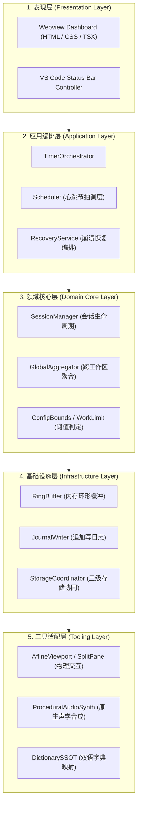
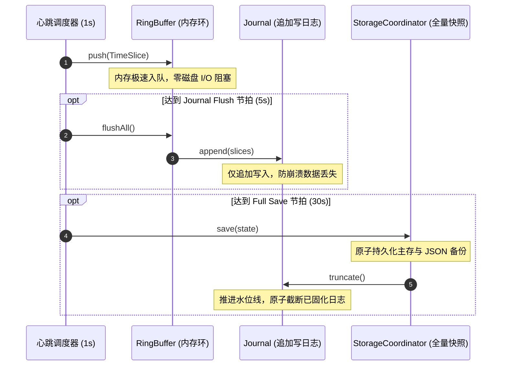
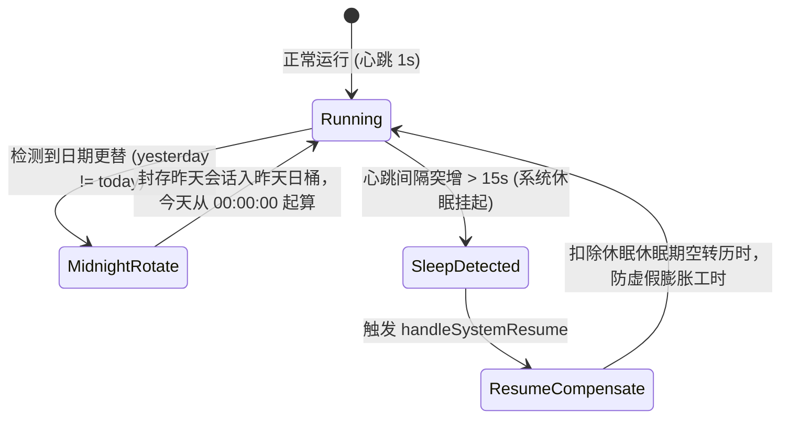

# VS Code 计时扩展五层解耦与双写崩溃安全架构规范

> 本文档为 `workspace-timing` VS Code 扩展的系统架构、分层解耦模型、双写崩溃持久化安全与用户交互工程规范。

---

## 一、 系统定位与工程挑战

`workspace-timing` 是一款专为开发者打造的高可靠、跨工作区编程时间量化与效能分析扩展。其核心技术挑战在于：
1. **进程非正常崩溃**：操作系统强制休眠、VS Code 主进程意外终止或异常停电；
2. **高频数据写入开销**：毫秒级心跳与高频时间片采样若直接频繁落盘，将导致磁盘 I/O 堵塞与固态硬盘磨损；
3. **长时间无人值守状态漂移**：系统休眠、远程桌面切换与跨午夜时间桶统计失真；
4. **UI 卡顿与视觉噪点**：海量会话数据下 Webview 渲染卡顿、边框套娃与样式冲突。

为此，系统确立**五层解耦架构**与**双写崩溃安全状态机**。

---

## 二、 严格五层解耦架构

系统严禁跨层调用与双向循环依赖，数据流向单向严格向下：

### 分层边界与工程约束

| 分层名称 | 职责定位 | 访问权限与禁令 | 典型组件 |
| :--- | :--- | :--- | :--- |
| **1. 表现层** | 负责 VS Code 状态栏渲染、Dashboard 视口自适应排版、全键盘无障碍漫游 | 严禁直接读取或修改物理磁盘文件，仅能通过消息总线向应用层发射意图 | `dashboard.html`, `StatusBarController` |
| **2. 应用编排层** | 统一管理心跳调度节拍（1s）、全量存盘节拍、崩溃启动诊断与恢复流水线 | 负责协调领域对象与基础设施，不承载具体的纯数学计算逻辑 | `TimerOrchestrator`, `Scheduler`, `RecoveryService` |
| **3. 领域核心层** | 跨工作区时间加总、会话跨午夜轮转、周工时上限裁定与容量淘汰 | 纯 TypeScript 逻辑，零第三方外部库依赖，可 100% 在无 VS Code 环境下执行单元测试 | `SessionManager`, `GlobalAggregator` |
| **4. 基础设施层** | 内存环形队列存储、追加式 WAL 日志写入、降频全量快照落盘 | 严禁承载业务时间统计逻辑，只提供原子存盘、崩溃截断与快照保障 | `RingBuffer`, `JournalWriter`, `StorageCoordinator` |
| **5. 工具适配层** | 二阶阻尼物理手柄、光标不动点仿射缩放、150ms 冷却图钉吸附、合成声效 | 纯无状态工具函数与 UI 数学模型，支持全局复用 | `AffineViewport`, `ScrollPinningController` |

---

## 三、 双写崩溃安全持久化模型

系统采用**内存环形缓冲（RingBuffer） + 追加式预写日志（WAL Journal） + 降频全量快照（Debounced Full Save）**三级协同机制：

### 1. 崩溃恢复与自愈流水线 (`RecoveryService`)
当 VS Code 启动或意外退出后重启时，系统按严格确定性顺序执行四步恢复：
1. **主存诊断**：读取主存快照；若主存损坏或丢失，自动降级提取本地 JSON 备份；
2. **Journal 日志回放**：提取最后一次全量存盘之后追加的所有有效时间切片；
3. **水位线去重**：严格过滤时间戳早于 `lastJournalTs` 的切片，严防双重计数；
4. **会话合成与原子截断**：合成未完结会话段，补偿系统历时，推进水位线并截断旧 Journal。

---

## 四、 跨午夜轮转与休眠补偿状态机

长时间运行中，物理时钟会发生突变（系统休眠 8 小时、夜间跨越 00:00:00）：

- **跨午夜轮转（`rotateSessionAtMidnight`）**：在午夜 24:00:00 将跨日期的连续会话精确裁切为两段，前段封存入昨天的 `dailyTotals`，后段作为今天的初始会话从 0 起算；
- **休眠自愈补偿（`handleSystemResume`）**：当检测到两心跳间隔大于 15 秒（操作系统进入挂起态），系统判定为物理休眠，休眠期间的时间不计入开发工时，避免产生动辄 10 小时的虚假开发会话。

---

## 五、 100% 国际化双语字典与交互物理契约

1. **零硬编码字符串（Zero Hardcoded Strings）**：
   - 表现层与导出报表的所有文本必须收口至 `package.nls.json` 与 `package.nls.zh-CN.json`；
   - 静态分析规则 `L3-HARDCODE` 实行一票否决拦截，严禁代码中散落裸英文字符串；
2. **交互物理学契约**：
   - **4px 移动死区防抖**：拖拽位移 $\le 4\text{px}$ 判定为生理微抖动，不触发视口位移；
   - **二阶阻尼谐振子**：分栏手柄拖拽溢出边界时施加 $0.7$ 物理阻尼柔化手感；
   - **150ms 冷却图钉吸附**：连续追加日志时，用户主动向上滚动脱离贴底后，视口提供 150ms 输入冷却窗口，禁止机械强制拉回底部；
   - **全键盘盲操漫游（`RovingFocusController`）**：支持 ArrowDown/ArrowUp/Home/End 键首尾回环漫游，自动跳过 `disabled` 元素。
