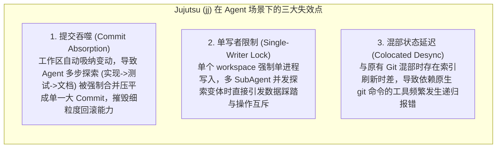

# 02. Git 现代生态与实验性路线调查与经验吸纳

> **所属模块**：`fractal-git/docs/`  
> **核心议题**：评估 Rust 现代 Git 库（`gix`、`jj`）与智能体工作树项目（`plasma-ai/fractal`）的技术得失，明确分形 Git 的取舍与超越策略。

---

## 1. 对 Gitoxide (`gix`) 的技术审视：管道层吸纳与瓷器层抛弃

`gitoxide`（简称 `gix`）是目前纯 Rust 生态中成熟完备的开源 Git 核心库，已被 Cargo 官方采纳为底层依赖抓取引擎。分形 Git 对其采取**“严格分层取舍”**策略：

```
                    ┌───────────────────────────────────┐
                    │      Gitoxide (gix) 架构全景      │
                    └─────────────────┬─────────────────┘
                                      │
         ┌────────────────────────────┴────────────────────────────┐
         ▼                                                         ▼
┌──────────────────────────────────────┐  ┌──────────────────────────────────────┐
│  高层瓷器层 (Porcelain) ──【显式解耦】 │  │  底层管道层 (Plumbing) ──【深度吸纳】 │
│  - gix-worktree: 单工作区物理绑定     │  │  - gix-object: 二进制对象极速编解码  │
│  - gix-index: 传统串行 index.lock    │  │  - gix-odb: 松散/打包对象内容寻址    │
│  - 缺陷: 继承面向人类的单线程锁争用  │  │  - gix-hash: SHA-1 / SHA-256 硬件加速│
│  - 缺陷: 多 Agent 频繁操作引发崩溃   │  │  - 优势: 纯数学无状态算子, 零锁开销  │
└──────────────────────────────────────┘  └──────────────────────────────────────┘
```

### 1.1 吸收的已证明优势
- **纯粹的 Plumbing 对象算法**：`gix-object` 提供了最优雅且内存安全的 Blob/Tree/Commit 二进制序列化与解析能力；
- **极速内容寻址 ODB**：`gix-odb` 支持 `memmap2` 零拷贝读取 Git loose/pack 对象，无额外堆分配，性能超越传统 C 原生 Git；
- **跨平台二进制兼容性**：写入的对象严格满足 Git 官方规范，外部标准客户端无缝识别。

### 1.2 抛弃的传统人类假设与弊端
- **摒弃 `gix-index`**：原生 Git 依赖单个 `.git/index` 记录状态。在数十个 Agent 并发运行时，`index.lock` 会造成严重的文件锁争用；分形 Git 移除物理磁盘索引，改用内存无锁树；
- **摒弃 `gix-worktree`**：传统工作树机制依赖全量物理文件检出，在大型工程中极易引发 I/O 悬崖。

---

## 2. 对 Jujutsu (`jj`) 的深度解剖：架构优势与 Agent 场景下的设计考量

Google 主导的 `jj`（Jujutsu）是目前开源界具有代表性的现代版本控制系统之一。分形 Git 吸收其理念精髓，同时深入规避其在 Agent 场景下的致命设计错配：

### 2.1 吸纳的已证明优势
1. **工作树即快照（Working Copy as Commit）**：消除了人类频繁遗漏 `git add` 的心智负担，任何受控状态在内存中即刻具有确定性哈希；
2. **冲突作为一等公民（First-Class Conflicts）**：合并冲突不会强行中断执行流，而是记录为带有冲突标记的拓扑节点，允许异步延迟化解；
3. **原生 Git 存储兼容**：直接基于 `.git/` 运行，无需自造私有存储孤岛。

### 2.2 暴露的 Agent 场景致命错配（The AI Agent Mismatch）
社区在尝试使用 `jj-lib` 构建 Agent 版本控制（如 `agentjj`）时，遭遇了三大架构局限：



> **分形 Git 的破解之道**：  
> 我们保留显式的**步次断点（Explicit Step Checkpoints）**，配合自相似多层工作树隔离（每个 SubAgent 独享独立内存树），从根本上避免提交被自动吞噬，同时保障多写并发安全。

---

## 3. 对 `plasma-ai/fractal` 的对比与超越

GitHub 上的开源项目 `plasma-ai/fractal` 敏锐地提出了“将代码库看作由 Git Worktrees 构成的递归树”的宏观概念，但其底层技术路线存在重大工程架构缺陷：

| 关键架构维度 | `plasma-ai/fractal` (当前开源方案) | `fractal-git` (本项目架构) | 架构代际差 |
| :--- | :--- | :--- | :--- |
| **底层实现栈** | **纯 Python 脚本**（封装原生 `git` CLI） | **Rust 原生内核**（gix plumbing）+ TS 编排 | Python 子进程开销巨大；Rust 微秒级操作，高并发零锁 |
| **工作区物理机制** | **原生物理 `git worktree add`**<br/>在磁盘真实全量拷贝目录与文件 | **LayerVFS 内存虚拟树 + 稀疏按需投影** | `plasma-ai` 启动数个工作树磁盘瞬间打满；我们 **`<3ms` 零物理拷贝** |
| **索引与阶段机制** | 原生 Git Index 索引区（易发生锁冲突） | **无锁内存虚拟索引（InMemoryTreeBuilder）** | 消除 `index.lock` 文件锁争用，并发冲突率降为 0 |
| **质量与安全防线** | **依赖模型自身检查 diff**<br/>（易被幻觉误导，无客观门禁） | **内核验证把关（TKCV 5维推导 <5ms）+ IKCE 隐藏微变异击杀率验证（击杀率 K >= 60%）+ 密码学遥测审计哈希链** | 不依赖模型自觉！形式化与微变异击杀率验证双重一票否决 |
| **全生命周期回收** | Python 脆弱的 `rm -rf` 脚本 | **Praxis 底层宿主毫秒级物理卸载与 DAG 保全** | 物理磁盘零残留，Git DAG 拓扑全息留存 |

---

## 4. 对 HatchZip (`xevrion/hatchzip`) 的技术审视与原位存储升华

`xevrion/hatchzip` 证明了逆向就地解压（In-Place Extraction）的可行性：通过逆向物理偏移提取 ZIP 成员并阶段性截断文件尾部，或利用稀疏文件（Sparse File Hole Punching）释放 TAR 块，从而打破传统解压 $S_{\text{archive}} + S_{\text{extracted}}$ 的双倍空间悬崖。分形 Git 评估其机制并完成系统级升华：

| 架构维度 | `xevrion/hatchzip` (桌面工具) | Taxis In-Place ODB Engine (原位存储引擎) | 演进与超越 |
| :--- | :--- | :--- | :--- |
| **应用定位** | 独立 C/Go 桌面解压程序 | **版本控制内核原位存储子系统** | 深度集成于 Git ODB 管道与 Bundle 传输流 |
| **容量预审** | 仅做简单静态剩余空间判断 | **SpacePlan 离散事件水位时序推演** | 基于 `i128` 宽整型模拟全流程槽位水位，空间不足提前熔断 |
| **崩溃一致性** | 进程崩溃或强杀后文件损坏 | **事务预写日志（InPlaceJournal）** | 每一批次必须经落盘与 fsync 屏障后方可截断尾部 |
| **中止可逆性** | 截断后无法回滚，归档永久报废 | **逆向重构自愈器（ArchiveRestorer）** | 中止时自动合成 Central Directory & EOCD，残包保持合规有效 |
| **对象库直通** | 仅能物化至普通工作区目录 | **直通 CAS ODB (`--to-odb`)** | 解压数据直接写入松散对象并生成 Commit，直接跳过工作区落盘 |
| **仓库 GC 联动** | 无 | **分片包递进轮转 (`repack --low-disk`)** | 分片打包校验后即刻销毁 loose 冗余，消除低磁盘 GC 死锁 |

---

## 5. 总结：分形 Git 的系统架构集成

分形 Git 是站在现代版本控制、多智能体系统与原位存储技术基础上的系统架构集成：
1. **汲取 `gix` 之长**：以 Rust 为内核，直接使用其最底层的无锁二进制对象与 ODB 算子；
2. **避开 `jj` 之短**：确立确定性的步次状态机，严防提交吞噬，实现多 Agent 无锁并发；
3. **超越 `plasma-ai` 之表**：将“分形工作树”从浅层的 Python 脚本封装，跃升为**“LayerVFS 虚拟存储 + Auto 形式化免疫系统 + 原生 Git 拓扑物化”**的系统级底层工程；
4. **内化 `hatchzip` 之道**：将原位就地解压升华为具备崩溃事务一致性（WAL）、可逆重构与 CAS ODB 直通的原位存储引擎（In-Place ODB Engine）。
