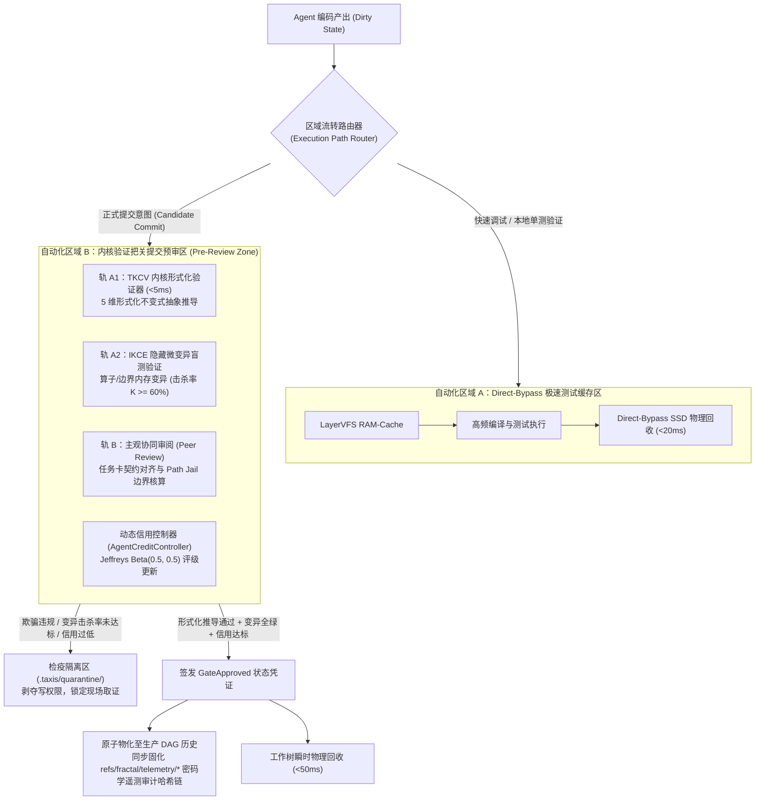
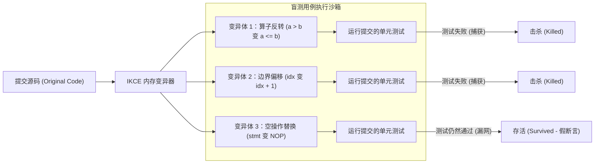
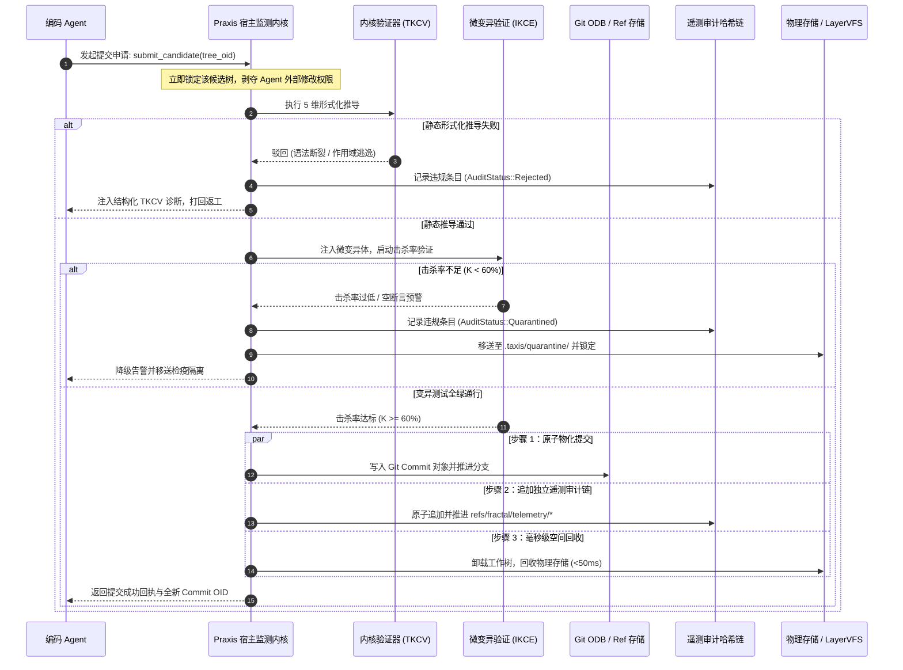

# 03. 提交预审区双轨互锁、内核验证器与检疫隔离规约

> **所属模块**：`fractal-git/docs/`  
> **核心议题**：阐明从传统 Git 盲目暂存向“提交预审区（Pre-Review Zone）”与“Direct-Bypass 极速测试缓存区”的范式跃迁，以及内核级抽象验证器（TKCV）、隐藏微变异击杀率验证（IKCE）、贝叶斯信用动态评级与检疫隔离（Quarantine）刚性闭环。

---

## 1. 范式跃迁：从盲目缓存到双自动化提交区域

### 1.1 传统 Git 暂存机制对智能体工程的致命缺陷
传统 Git 的工作缓存（Staging Area / Index）是一个**“冷酷盲目、毫无质量感知”**的物理堆放场：
- 人类或 Agent 执行 `git add`，无论代码中存在多少未闭合括号、语法崩坏、死循环还是内存泄漏，Git Index 毫无察觉；
- 只要调用 `git commit`，缺陷直接封包为不可变的 Commit 对象，进入永久 DAG 历史；
- 在多智能体并行协作环境中，大语言模型倾向于寻求阻力最小路径，极易产生注释断言、空测试打卡、虚构逻辑或遗漏物理回收等行为。

### 1.2 双专属自动化提交区域架构
分形 Git 废黜了单一盲目暂存机制，确立了职责正交分离的**双专属自动化提交区域**：



### 1.3 提交预审区的核心公理与刚性底线
1. **未达标禁止物化（No Gate, No Commit）**：在未取得 `WorktreeState::GateApproved` 状态前，底层内核拒绝为该工作树生成任何 Git Commit 对象，拒绝推进任何 Git 引用指针；
2. **瞬态试错零污染**：Agent 在预审区内的试错、微调与多次候选变体验证全在内存快照中进行，不污染底层的 Git ODB 历史；
3. **“测试通过非达标”防线公理**：单测全绿仅代表已知输入未崩溃，必须同时通过内核验证器（TKCV）形式化推导与微变异击杀率（IKCE）考验；
4. **全生命周期防篡改留痕**：每一次预审的胜出、驳回或检疫，均通过单向密码学哈希链原子写入 `refs/fractal/telemetry/*` 遥测审计分支。

---

## 2. 内核形式化推导验证器（TKCV - Taxis Kernel Correctness Verifier）

为了消解“智能体写死虚假测试”、“空断言”和“通过死代码绕过静态分析”等规避检测与指标刷分行为，Taxis 内置了轻量级形式化推导验证器，直接在内核层对代码 AST 与控制流展开 5 维不变式校验。

### 2.1 五维形式化抽象推导不变式

```
+---------------------------------------------------------------------------------+
|                  TKCV 形式化抽象推导 5 维不变式矩阵                              |
+---+--------------------+------------------------+-------------------------------+
| # | 不变式名称         | 形式化检验目标         | 防范的规避手段与质量退化      |
+---+--------------------+------------------------+-------------------------------+
| 1 | AST 平衡性与闭包   | 括号/作用域完整封闭    | 语法截断、半成品代码提交      |
| 2 | 符号可达性与活性   | 零死函数、无孤立导出   | 编写假实现但无实际调用链路    |
| 3 | 纯函数无害等价性   | 关键路径零未声明副作用 | 在只读方法中隐藏隐蔽状态突变  |
| 4 | 内存生命周期单向性 | 句柄成对释放、零悬挂   | 环形缓冲句柄泄露、资源遗失    |
| 5 | 类型与错误穷尽性   | 匹配分支完全穷尽       | 宽泛 catch(e){} 吞没核心错误   |
+---+--------------------+------------------------+-------------------------------+
```

### 2.2 推导执行性能契约
- **推导耗时预算**：单个工作树增量切片的推导时间必须控制在 **$< 5\text{ms}$**；
- **纯内存静态遍历**：推导过程严禁发起磁盘写 I/O 或网络通信，在只读内存切片上完成线性扫描；
- **一票否决机制**：5 维不变式中若有任意一条断言失败，立即中断后续变异测试，生成结构化违规诊断直接打回。

---

## 3. 隐藏微变异击杀率验证引擎（IKCE - In-Kernel Canary Engine）

静态分析能阻止语法与结构违规，但无法探知测试用例是否具有真实断言价值。Taxis 引入内核隐藏微变异击杀率验证引擎，充当代码审查的“金丝雀（Canary）”。

### 3.1 盲测用例变异测试与算子注入
在 Agent 提交代码后，IKCE 自动在内存中对生产代码实施微扰动（Micro-Mutation），生成若干变异体（Mutants）：



### 3.2 变异击杀率公式与质量门禁判定
变异击杀率 $K$ 的定义为：

$$K = \frac{D_{\text{killed}}}{D_{\text{total}}} \times 100\%$$

- **击杀门槛刚性基线**：$K \ge 60\%$。
- **无效断言甄别算法（Zero-Assertion Detection）**：若单元测试在多个关键逻辑变异体注入后依然全部维持绿灯通过，判定该测试集存在“空断言”或“假测试”。
- **惩罚性动作**：变异击杀率低于 $60\%$ 的提交将被立即打回，并计入 Agent 信用扣分；低于 $30\%$ 的提交判定为恶意欺骗，直接移送检疫隔离。

---

## 4. 贝叶斯动态信用评级与检疫隔离（Quarantine）

### 4.1 基于 Jeffreys Beta(0.5, 0.5) 的客观信用更新
Taxis 摒弃基于主观印象的信誉机制，采用完全客观的共轭后验概率分布对 Agent 进行信誉追踪：

- **先验分布**：$\text{Beta}(\alpha_0 = 0.5, \beta_0 = 0.5)$（无偏弱先验）；
- **后验更新规则**：
  $$\alpha_{t+1} = \alpha_t + \mathbb{I}(\text{Pass}), \quad \beta_{t+1} = \beta_t + \mathbb{I}(\text{Fail})$$
- **信用分（Credit Score）计算**：
  $$\text{Credit} = 100 \times \frac{\alpha}{\alpha + \beta}$$

### 4.2 信用分级自适应审查策略

| 信用分区间 | 评级定位 | 预审流水线调度策略 |
| :--- | :--- | :--- |
| **$[90, 100]$** | 高信度智能体 (Trusted) | 启用极速通道：TKCV 验证 + 5 个代表性变异体抽检，预审耗时 $<50\text{ms}$ |
| **$[75, 90)$** | 常规智能体 (Standard) | 完整通道：TKCV 验证 + 全量微变异击杀率验证 ($K \ge 60\%$) |
| **$[60, 75)$** | 观察期智能体 (Probation) | 深度穿透：变异击杀率要求提高至 $75\%$，且引入历史用例全量回归校验 |
| **$[0, 60)$** | 不信任智能体 (Distrusted) | 冻结独立提交权限：所有产出强制直达检疫隔离区，由高级审计专员人工复审 |

### 4.3 物理检疫隔离机制（Quarantine Isolation）
当代码触发严重违规特征（如恶意篡改审计日志、连续两次变异击杀率 $<30\%$、或存在高危指令注入风险）时，内核立即执行物理隔离：

```
.taxis/
└── quarantine/
    └── 20261030-a8f1b9-agent_42/
        ├── candidate.patch       # 隔离被锁定的代码补丁
        ├── violation-report.json  # TKCV/IKCE 违规检测诊断
        ├── forensic-audit.log    # 取证日志
        └── .isolated             # 操作系统级写保护标记
```

1. **写权限瞬间剥夺**：通过操作系统 ACL 将工作树设为只读，Agent 无法就地销毁现场；
2. **工作树移送与隔离**：物理路径重命名至 `.taxis/quarantine/`；
3. **事件告警与自愈派发**：触发系统级警报，通知编排层降权该 Agent，并派发专门的修复任务。

---

## 5. 密码学防篡改独立遥测审计链（`refs/fractal/telemetry/*`）

### 5.1 独立遥测链数据拓扑
审计链独立于常规代码分支（如 `refs/heads/main`），存储在 Git 原生底层但隔离的命名空间中：

```
refs/fractal/telemetry/
├── agents/
│   ├── agent_worker_01   -> [Commit: Telemetry Entry 3]
│   └── agent_reviewer_02 -> [Commit: Telemetry Entry 7]
└── system/
    └── global_audit_trail
```

### 5.2 单向不可逆哈希链构造
每个审计条目包含：
- `prev_audit_hash`：上一条目密码学散列；
- `git_commit_oid`：关联的代码 Commit OID（若被驳回则为 `0000...`）；
- `verifier_scores`：TKCV 与 IKCE 综合得分；
- `timestamp`：确定性微秒级时标；
- `signature`：宿主内核数字指纹。

任何对历史审计记录的删改均会导致哈希链断裂，无法通过 `taxis quality trace` 校验。

### 5.3 操作系统级物理加固
物理存储落盘时，系统自动调用平台专用底层调用保护数据安全：
- **Windows 环境**：调用 Win32 API 移除写访问权限，施加只读锁；
- **Linux 环境**：调用 `chattr +a` 施加“仅追加（Append-Only）”扩展属性，防止非特权进程直接修改或清空审计文件。

---

## 6. 宿主系统全自动物理接管与回收流转

### 6.1 全自动审查接管时序图



### 6.2 物理回收耗时与资源释放契约
1. **Direct-Bypass 测试缓存回收**：测试完成即刻清空，全量物理回收耗时 **$< 20\text{ms}$**；
2. **SubAgent 瞬态树回收**：变体评估仲裁后，未采纳候选分支内存即刻注销，胜出分支物化合入后 **$< 50\text{ms}$** 完成工作树目录擦除；
3. **零垃圾残留保障**：物理文件系统由内核使用严格的句柄闭合与文件锁释放策略，坚决避免 Windows 系统上常见的 `EBUSY` 或 `AccessDenied` 句柄泄露挂起问题。
