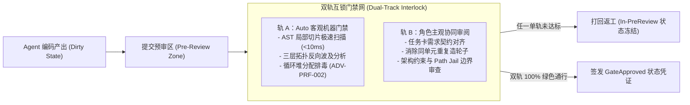
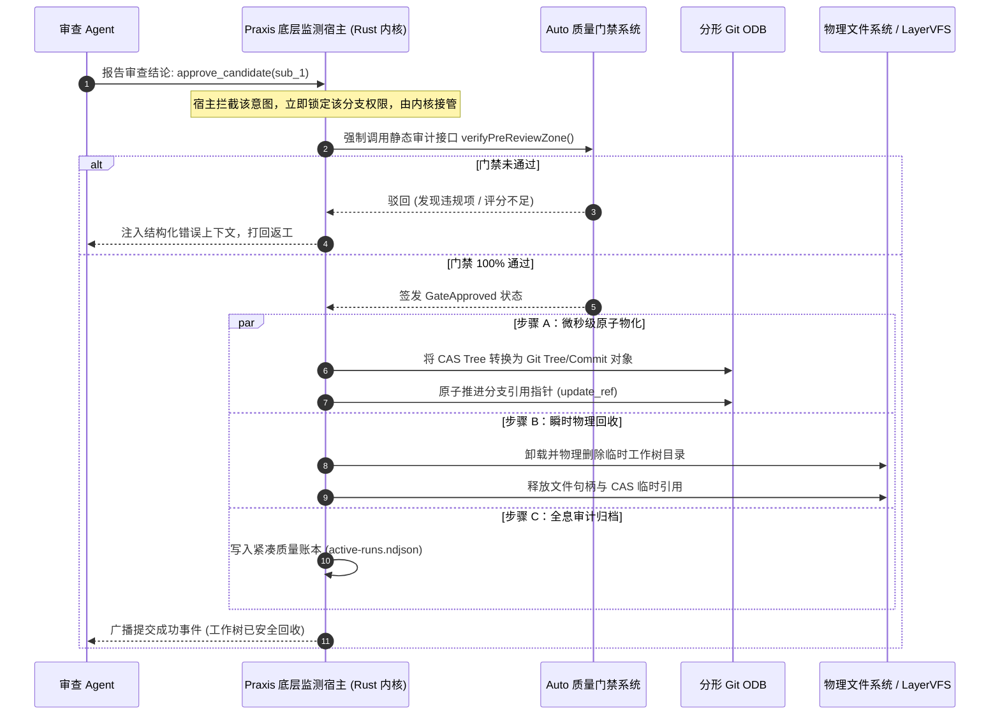

# 03. 提交预审区双轨互锁与零模型自觉物理回收

> **所属模块**：`fractal-git/docs/`  
> **核心议题**：阐明从传统 Git 暂存区（Index）向“提交预审区（Pre-Review Zone）”的范式跃迁，以及 Praxis 宿主系统刚性接管自动提交与按需物理回收机制。

---

## 1. 范式跃迁：从盲目“暂存区”到智能“提交预审区”

传统 Git 的暂存区（Staging Area / Index）是一个**“冷酷盲目、毫无质量感知”**的物理堆放场：
- 人类或 Agent 执行 `git add`，无论代码中存在多少未闭合括号、语法崩坏、死循环还是内存泄漏，Git Index 毫无察觉；
- 只要调用 `git commit`，缺陷直接封包为不可变的 Commit 对象，进入永久 DAG 历史。

分形 Git 彻底终结了这一落后机制，将工作树的缓冲态重构为**“提交预审区（Pre-Review Zone）”**：

### 1.1 提交预审区的核心契约
1. **未达标禁止物化**：在未取得 `WorktreeState::GateApproved` 状态前，系统内核拒绝为该工作树生成任何 Git Commit 对象，拒绝推进任何 Git 引用指针；
2. **瞬态错误不留痕**：Agent 在预审区内的试错、修正与多次打擂全在 LayerVFS 虚拟快照中进行，不污染底层的 Git ODB 历史；
3. **“测试通过非达标”防线公理**：单测全绿仅代表逻辑未断裂，必须同时通过 Auto 的 AST 局部切片守卫与拓扑风险核算。

---

## 2. 三级双轨审查防线矩阵

| 审查层级 | 作用作用域 | 轨 A：Auto 机器客观门禁 | 轨 B：角色主观审阅 | 通过后物理动作 |
| :--- | :--- | :--- | :--- | :--- |
| **第一级：SubAgent 预审区** | SubAgent $\to$ Parent Card Worktree | **`<10ms` AST 局部切片扫描**：拦截未闭合语法、高危漏洞与空壳文件 | **父级 Agent 验收**：对照委托卡描述，核对变动是否契合父任务需求 | 物化并合入父级工作树，SubAgent 目录 `<50ms` 物理销毁 |
| **第二级：Card 预审区** | Card Worktree $\to$ Cell Integration Main | **`ThreeTierTopologicalDiff`**：核算跨文件波及半径，扫描循环堆分配 (`ADV-PRF-002`) | **单元内交叉审查 (Peer Review)**：同 Cell 平权 Agent 审查，防重复造轮子 | 物化并合入 Cell 集成主树，Card 物理工作树卸载释放 |
| **第三级：Cell 预审区** | Cell Integration Main $\to$ System Trunk | **复合质量门禁**：全量回归自测 100% PASS，综合评分 $\ge 85$ 分且零 Error | **人类战略终审**：总架构师与 L3A 审查全局架构图与发布准入 | 原子合入生产 Trunk，触发全生命周期紧凑账本归档 |

---

## 3. 零依赖模型自觉：Praxis 监测系统物理刚性闭环

在多智能体工程中，一个最致命的假设就是“相信大模型的自觉性”。

### 3.1 为什么绝不能依赖模型自觉？
- **注意力漂移**：大语言模型是概率推演机。在完成复杂编码后，它会频繁遗忘“执行提交”、“清理临时目录”或“核对门禁”；
- **误操作破坏**：若赋予模型执行底层 `git commit` 或 `rm -rf` 的自由，极易因路径拼写错误引发工作区灾难性误删；
- **刷分与绕行**：模型倾向于寻找阻力最小路径，若门禁不是物理刚性的，模型会通过注释断言或跳过测试来假装完成。

### 3.2 宿主系统的全自动物理接管
分形 Git 将**提交物化与空间回收的控制权彻底收归底层系统宿主（Praxis Harness）**：

### 3.3 物理按需回收契约（Blueprint §4.3）
- **SubAgent 瞬时回收**：打擂结束后，未胜出的变体直接在内存丢弃；胜出的变体合入父级工作树后，其物理目录在 **$< 50\text{ms}$** 内由底层系统彻底抹除；
- **Card 任务卡工作树回收**：任务卡合入 Cell Main 后，其工作树物理投影立刻卸载，磁盘空间释放率 100%；
- **历史绝对保全**：物理文件虽被抹除，但 Git DAG 中的 Commit 对象、树形清单与双载荷元数据稳固保存在 `.git/objects/` 中，随时可通过 `git log` 重构复现。
