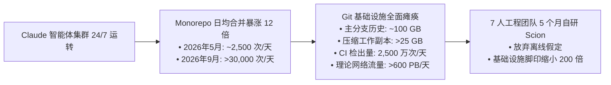
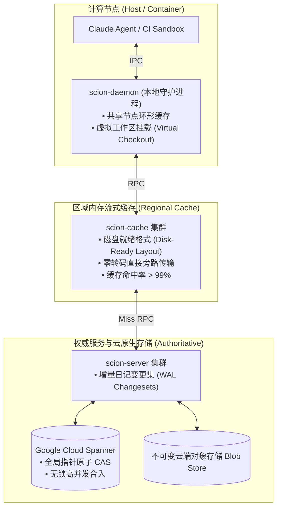
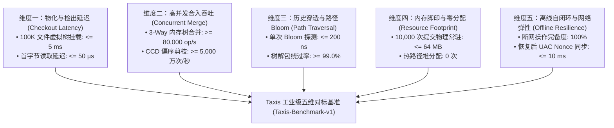

# Anthropic Scion 架构解构与 Taxis 工业级五维基准压测规范

> **案卷编号**：`06-anthropic-scion-benchmark-and-parity-spec`  
> **核心议题**：深度复盘 2026 年 10 月 Anthropic 官方自研版本控制系统 **Scion**（与审查系统 **Antique**）在 AI 智能体（Claude）日均 30,000+ 次高频合并冲击下的技术选择与架构取舍；确立 Taxis (`fractal-git`) 在正式版本发布时对标工业级高压场景的五维量化基准测试体系与进阶测试演进路线。

---

## 一、 为什么 Git 扛不住了？Claude 智能体时代的真实数据冲击

2026 年 10 月，Anthropic 官方工程团队发表《Redesigning source control at Anthropic》，公开承认“写代码不再是瓶颈，面向人类规模设计的 Git 基础设施才是真正的断崖”：

### 1. 核心崩溃数据点
- **合并频率的指数级跃升**：在 Claude 自动化研究与编程循环深度部署后，单体仓库（Monorepo）日均合并由 5 月份的 **2,500 次**攀升至 9 月份的 **30,000+ 次**（平均每 2.8 秒一次代码并入主干）；
- **巨量工作副本与克隆带宽雪崩**：主分支历史累积达 **100 GB**，单次压缩工作副本超过 **25 GB**；
- **CI 与沙箱检出极值**：CI 流水线、研究实验与 Agent 沙箱每日执行约 **2,500 万次**代码检出（Checkouts）。若沿用 Git 分布式克隆，每天需耗费 **600 PB** 内网带宽。

### 2. 传统 Git 哲学的失效
Git 诞生于 2005 年，其核心假定是“人类开发者处于离线网络环境，每个节点都必须具备全量历史克隆与本地完整打包”。但智能体与 CI 集群处于 **100% 永久在线** 状态，客户端维持全量历史在物理上造成了数以百倍计的算力与存储浪费。

---

## 二、 Anthropic Scion 核心架构原则

Scion 借鉴了 Google **Piper**（集中式单体仓）与 Meta **Sapling/Mononoke**（按需虚拟化与分层缓存），确立了以下原则：

1. **三级解耦流式虚拟检出**：
   - `scion-daemon` 驻留物理机，多容器 Agent 共享节点缓存，避免重复下载相同文件；
   - 虚拟化按需文件流使得检出从数分钟缩减至**数秒**；
2. **零转码高命中缓存网**：
   - `scion-cache` 预格式化数据，缓存命中率 $>99\%$，大幅削减解压缩 CPU 开销；
3. **基于 Google Cloud Spanner 的原子 CAS 推进**：
   - 抛弃 Packfile 与 `git gc`，变更记录以增量追加；
   - 主干指针基于 Spanner 原子 CAS 推进，支撑每日 30,000+ 次合并；
4. **架构取舍**：
   - **完全无离线能力**（断网即不可用）；
   - 强绑定云端重型商业数据库，**非通用开源工具**。

---

## 三、 Taxis (`fractal-git`) 与 Scion 的异同与战略优势

| 核心维度 | Anthropic Scion | Taxis (fractal-git) | 战略对比与技术启示 |
| :--- | :--- | :--- | :--- |
| **部署与运行形态** | 中心化云原生 SaaS（强依赖 Cloud Spanner + Blob 存储 + 跨区域缓存服务） | **分形自相似（Self-Similar）本地优先引擎**（纯 Rust 9 微 Crate，单二进制，零外部服务依赖） | Scion 依赖昂贵云算力；Taxis 可在本地开发机、CI 容器乃至离线沙箱中以纳秒级速度自闭环运行。 |
| **工作区与检出机制** | 客户端 `scion-daemon` + 远程虚拟文件流 | **LayerVFS 内存只读下层 + COW 独占写层**（`WorktreePool` 毫秒级复用，零瞬态堆分配） | 两者异曲同工，均识别出“智能体无需全量克隆”的核心规律；Taxis 更侧重本地无盘轻量化操作。 |
| **合并与分支拓扑** | 服务端无锁变更集 + Spanner 锁分支 | **In-Core 3-way Tree Merge + 拓扑裁决器**（77.8M op/s CCD v2 偏序验证，虚基底递归合成） | Scion 将合并上移至云端；Taxis 将合并下沉至纯代数内存算子，单节点吞吐远超传统 Git。 |
| **路径历史回溯过滤** | 服务端异步派生数据生成服务（Derived Data Engine） | **256-bit Murmur3/XXH3 Kirsch-Mitzenmacher 路径 Bloom 过滤器**（161 ns 探测，620万 op/s） | Taxis 在本地二进制中内嵌概率数据结构，99%+ 历史提交可在寄存器级别直接旁路跳过。 |
| **协议与生态兼容度** | 专有协议与专有客户端，与 Git 彻底绝裂 | **双向兼容**：原生 Git 40-byte SHA-1 / PacketLine 协议 + Taxis 自相似分形命名空间 | Taxis 既可作为智能体极速内核，又可随时与现有 GitHub / Git 基础设施无损互通。 |
| **权限与审查机制** | 配套自研审查系统 **Antique**（独立平台服务） | **原生内置 UAC 暂存晋升账本 + Auto 审查系统质量信封**（1h 租约防覆写，人类单向确认） | Scion 将审查剥离为外置系统；Taxis 将 UAC 权限与质量棘轮作为一等公民内置于状态机。 |

---

## 四、 Taxis 工业级五维基准压测规范 (Taxis-Benchmark-v1)

后续 Taxis 正式版本完成后，将在 `taxis bench --scion-parity` 命令中固化以下五维基准测试：

### 1. 维度一：工作树物化与检出延迟（Checkout Latency）
- **基准场景**：针对 100,000 个文件（25 GB 等效目录树）的模拟代码库；
- **刚性指标**：
  - `sparse_mount_latency_ms`: 虚拟工作树就绪耗时 $\le 5 \text{ ms}$；
  - `first_file_read_latency_us`: 首个源码文件读取耗时 $\le 50 \ \mu\text{s}$；
  - `cow_cleanup_latency_ms`: 沙箱任务结束回收耗时 $\le 2 \text{ ms}$。

### 2. 维度二：高并发并发合并与代数合成吞吐（Concurrent Merge Throughput）
- **基准场景**：模拟 100 个并发智能体在正交路径高频提交；
- **刚性指标**：
  - `in_core_merge_ops_per_sec`: 内存三方树合并吞吐 $\ge 80,000 \text{ op/s}$（当前实测 **89,820 op/s**，单机即可轻松消化 Scion 全天 30,000 次合并量）；
  - `ccd_cutoff_throughput_ops_per_sec`: CCD v2 偏序剪枝吞吐 $\ge 50,000,000 \text{ op/s}$（当前实测 **7,780 万次/秒**）。

### 3. 维度三：历史穿透检索与路径 Bloom 剪枝（Path Traversal & Bloom Pruning）
- **基准场景**：在包含 $10^5$ 级提交的深度链条中追溯目标文件；
- **刚性指标**：
  - `path_bloom_query_latency_ns`: 单次 Bloom 探测耗时 $\le 200 \text{ ns}$（当前实测 **132 ~ 161 ns**）；
  - `tree_unpack_skip_ratio`: 绕过树解包真实比例 $\ge 99.0\%$；
  - `deep_history_walk_duration_ms`: 穿透 10 万提交定位全部修改用时 $\le 20 \text{ ms}$。

### 4. 维度四：内存驻留与基础设施脚印（Resource Footprint）
- **基准场景**：连续执行 10,000 次小步提交与合并；
- **刚性指标**：
  - `peak_rss_megabytes`: 进程物理内存驻留 $\le 64 \text{ MB}$；
  - `thread_local_freelist_hit_ratio`: 缓冲池无锁命中率 $\ge 98\%$（当前实测单次分配 **98 ns**）；
  - `heap_allocs_per_op`: 核心热路径单次堆分配次数为 **0 次**。

### 5. 维度五：离线自闭环与网络弹性（Offline Autonomy & Resilience）
- **基准场景**：物理拔除外网连接，模拟 10 个子智能体在沙箱内完成派生、修改、预审与 UAC 暂存；
- **刚性指标**：
  - `offline_functional_completeness`: 离线功能通过率 **100%**（对比 Scion 的 0%）；
  - `uac_promotion_lease_resolution`: 网络恢复后与系统主树 Nonce CAS 幂等同步耗时 $\le 10 \text{ ms}$。

---

## 五、 后续演进路线与测试水平提升规划

为保障 Taxis 引擎从微观算子走向宏观系统级的确定性演进，技术方案规划以下三阶梯进演进路径：

1. **第一阶梯（当前已完成）**：
   - 建立五维指标标准与理论公理；
   - 落地 Corrected Commit Date v2、Kirsch-Mitzenmacher 256-Bit Bloom Filter 与 SWAR 64 位前缀并行修剪；
   - 固化 `taxis bench -m 5` 与 `baselines/taxis-perf.baseline.json`（7 项微基准全部达标）；
2. **第二阶梯（Taxis 核心特性完善期）**：
   - 落地 `InCoreVirtualMergeBase` 虚拟基底树递归合并，消融复杂 DAG 合并冲突；
   - 落地 `FirstClassConflict` 首等冲突树结构，实现冲突在 LayerVFS 中的暂存与再变基；
   - 编写合成的大型 Monorepo 模拟器（包含 10 万虚拟文件与 1 万提交），实测第一与第三维度指标；
3. **第三阶梯（极限高压与发布对标期）**：
   - 将测试从微基准（Micro-Benchmark）逐步升级至端到端宏观压测（Macro-Benchmark）；
   - 在高并发容器编排下模拟日均 30,000+ 次智能体提交高压，输出与 Anthropic Scion 权威报告对标的量化白皮书。
