# 08 — Taxis In-Place Storage Engine (TIPSE) Specification

> **Subsystem**: `fg-storage::in_place`, `fg-algorithms::space_plan`, and CLI `taxis unarchive`  
> **SSOT Contracts**: `FGT-STO-001` (Crash Safety & In-Place Consistency), `FGT-PRF-001` (Zero Transient Allocation), `FGT-COR-001` (Domain Error Closure)

---

## 一、 架构动机与核心问题

传统版本控制系统与解压工具在解包大型归档（ZIP / TAR）或导入 Git Bundle 时，必须维持 $S_{\text{archive}} + S_{\text{extracted}}$ 的双倍磁盘空间峰值占用。在存储受限的环境（CI Docker 容器、云开发容器、边缘设备）中，极易触发 `ENOSPC` 磁盘耗尽异常。

TIPSE (Taxis In-Place Storage Engine) 内化并升级了逆向就地截断（Tail-First In-Place Truncation）与前向打洞（Forward Hole Punching）机制，确保解压过程中释放的空间动态反哺新解压数据，将峰值空间占用降为：

$$\text{PeakDiskUsage} = \max(S_{\text{archive}}, S_{\text{extracted}}) + \Delta_{\text{batch}}$$

---

## 二、 关键模块架构与数据流

```mermaid
flowchart TD
    subgraph Preflight ["1. 预审规划 (SpacePlan)"]
        SP1["解析归档目录 (ZIP EOCD / Tar Header)"] --> SP2["离散水位推演 (simulate_space_plan)"]
        SP2 --> SP3{"最低水位 >= 冗余阈值?"}
        SP3 -->|否: 空间不足| SP_REJECT["抛出 InsufficientDiskSpace 阻断"]
        SP3 -->|是: 空间安全| SP_PASS["进入就地执行"]
    end

    subgraph Execution ["2. 逆向尾部截断流水线 (Tail-First Order)"]
        E1["按物理偏移从大到小逆向提取"] --> E2["数据解压落盘并校验 CRC32"]
        E2 --> E3["WAL 写入 MemberExtracted 事务记录并 fsync"]
        E3 --> E4["达到自适应批次窗口 (16MB~64MB)"]
        E4 --> E5["TailTruncator 物理截断归档尾部并 sync"]
        E5 --> E6["归档释放空间供下一批次使用"]
    end

    subgraph Reversibility ["3. 异常回滚与自愈 (ArchiveRestorer)"]
        R1["用户中止 / 进程异常中断"] --> R2["WAL 重放游标与已提取成员表"]
        R2 --> R3["重新合成合法 Central Directory 与 EOCD"]
        R3 --> R4["残留归档恢复为完全合规的微缩有效归档包"]
    end
```



---

## 三、 核心构件与 API 契约

### 1. `fg-algorithms::space_plan`
- **[`SpacePlanConfig`](../crates/fg-algorithms/src/space_plan/mod.rs#L50-L87)**：支持安全预留空间阈值与自适应批次窗口（16MB ~ 64MB），防范 OS 系统调用抖动。
- **[`simulate_space_plan`](../crates/fg-algorithms/src/space_plan/mod.rs#L143-L235)**：基于有符号宽整型 (`i128`) 的离散事件时序推演，精确捕捉全流程最低水位（Trough Level），杜绝无符号溢出。
- **[`check_headroom`](../crates/fg-algorithms/src/space_plan/mod.rs#L261-L265)**：断言预审可行性，不达标抛出 `FractalError::InsufficientDiskSpace`。

### 2. `fg-storage::in_place`
- **[`TailTruncator`](../crates/fg-storage/src/in_place/tail_truncator.rs#L18-L121)**：
  - 维护单调非增截断不变量（`new_len <= current_len`），严禁物理扩充文件。
  - 跨平台调用 `SetEndOfFile` (Windows) 与 `ftruncate` (POSIX)，并强制落盘 `sync_all`。
- **[`HolePuncher`](../crates/fg-storage/src/in_place/hole_puncher.rs#L18-L107)**：
  - Windows/NTFS 适配：`FSCTL_SET_SPARSE` + `FSCTL_SET_ZERO_DATA` 原生解构文件 extents。
  - Linux 适配：`fallocate(FALLOC_FL_PUNCH_HOLE | FALLOC_FL_KEEP_SIZE)`。
- **[`ArchiveRestorer`](../crates/fg-storage/src/in_place/restorer.rs#L16-L76)**：
  - 在解压异常中断或主动回滚时，为残留文件合成有效的 Central Directory 与 EOCD。
- **[`InPlaceBundleConsumer`](../crates/fg-storage/src/in_place/bundle_consumer.rs#L29-L133)**：
  - 吞噬 Git Bundle v2 并原地生成 `.pack` 与 `.idx`，消费后截断 Bundle 文件。
- **`RepackEngine::repack_repository_low_disk`**：
  - 微分型包递进轮转（Micro-Pack Slicing，默认 64MB~256MB），每生成并验证一个微包即刻物理删除对应的 Loose Objects，根治低磁盘 GC 死锁。

---

## 四、 命令行接口 (CLI)

### 1. `taxis unarchive`
```bash
# 模拟执行并显示水位推演看板（不修改磁盘字节）
taxis unarchive archive.zip --dest ./output --dry-run

# 执行逆向就地解压与截断
taxis unarchive archive.zip --dest ./output --in-place

# 针对 .tar.gz 使用前向打洞稀疏化
taxis unarchive archive.tar.gz --dest ./output --batch-window 32M

# 直通 CAS 对象库 (ODB) 模式：跳过工作区落盘，直接写入 Loose Objects 并组装 Commit
taxis unarchive repo-export.zip --to-odb --branch main

# 仅导入构造树对象（输出 Root Tree OID，不创建 Commit）
taxis unarchive repo-export.zip --to-odb --tree-only
```

### 2. `taxis bundle unbundle`
```bash
# 原位消费 Git Bundle，直接转换为 .pack/.idx 并更新引用
taxis bundle unbundle repo.bundle

# 消费后自动截断并释放源 Bundle 文件空间
taxis bundle unbundle repo.bundle --in-place
```

### 3. `taxis repack --low-disk`
```bash
# 在剩余磁盘紧张时启用微包递进轮转重打包
taxis repack --low-disk --micro-pack 64M
```
