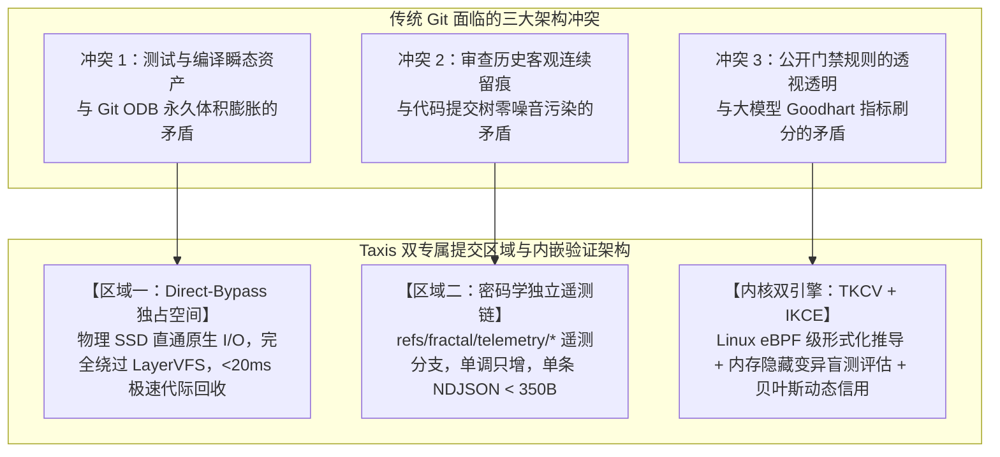
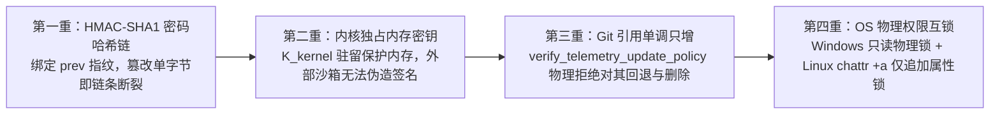

# 09. 专属测试与编译缓存区、内核验证器与密码学防篡改独立遥测审计规约

> **所属模块**：`fractal-git/docs/`  
> **核心议题**：系统阐述 Taxis 双自动化专属提交区域的权威架构规约——涵盖 Direct-Bypass 独占测试与编译缓存直通空间、Taxis 内核代码验证器（TKCV，对标 Linux eBPF Verifier）、实时隐藏探针微变异击杀率验证引擎（IKCE）、贝叶斯动态信用流控总督、以及密码学防篡改遥测审计账本（`refs/fractal/telemetry/*`）与分层历史归约台账。  
> **关联 Crate**：`fg-core`, `fg-pools`, `fg-topology`, `fg-gate`, `fg-storage`, `fg-native`  
> **SSOT 契约**：`FGT-COR-001`, `FGT-STO-001`, `FGT-GAT-001`, `FGT-TOP-001`, `FGT-LCK-001`, `FGT-PRF-001`, `FGT-VRF-001`, `FGT-POL-001`, `FGT-TRN-001`

---

## 一、 架构第一性原理与核心矛盾消解

在多智能体（Multi-Agent）高频并发试错与自治进化的版本控制系统中，传统 Git 单一工作区模型暴露出三大根本性物理与机制冲突：



1. **瞬态资产与 Git 树纯净的物理冲突**：编译中间产物（`.tsbuildinfo`、Rust `target/`）、快照测试黄金文件（Snapshot Fixtures）若被提交进 Git 树，将导致对象数据库（ODB）以数 GB 规模永久膨胀，引发网络拉取与差分树计算严重卡顿；若仅采用 `.gitignore`，不同智能体并发争夺同一物理目录，必然产生时间戳混淆与文件锁死锁；
2. **审计连续性与代码 DAG 零噪音的冲突**：智能体的代码演化、测试覆盖、变异击杀与技术债消除轨迹必须作为不可磨灭的数据资产存档；但若直接提交至生产代码分支（例如不断在根目录提交 `audit-report.json`），将导致 `git log` 被流水账淹没，且不同智能体的报告文件产生持续并发合并冲突；
3. **公开门禁的 Goodhart 效应陷阱**：根据 Goodhart 定律（“当指标变成目标，它就不再是好指标”），一旦静态审查与单测覆盖规则完全固定公开，大模型会倾向于生成空断言（`assert!(true)`）、硬编码返回值或虚假重构骗取 100 分。

为此，Taxis 在内核底层划设**两大自动化专属提交区域**，并内嵌 **TKCV 形式化推导验证器** 与 **IKCE 实时隐藏探针微变异击杀率验证引擎**。

---

## 二、 区域一：Direct-Bypass 独占测试与编译缓存空间

### 2.1 物理 SSD 直通机制 (Native SSD Bypass)
针对测试数据与编译缓存，绕开虚拟文件系统（LayerVFS）与 Git 内存索引（`InMemoryIndexTree`）的封装抽象，直接开辟宿主物理 SSD 槽位：

```
.taxis/worktrees/{slot_id}/
├── cache/                  # Direct-Bypass 独占增量编译缓存空间
└── test-store/             # Direct-Bypass 独占大型测试夹具与金样快照空间
```

- **读写性能**：直接利用宿主操作系统 NVMe SSD 原生读写能力，避免虚拟文件层系统调用代理开销；
- **槽位物理隔离**：每个并发 SubAgent 或私有 Card 分配独占槽位（`slot_000` $\sim$ `slot_063`），槽位间严格无交集，避免并发竞争；
- **提交树隔离**：两个目录在文件系统层面被划定于提交索引之外，不纳入提交索引与对象库存储。

### 2.2 `<20ms` 物理回收与安全防误删污点追踪 (`FGT-POL-001`)
在工作树生命周期完结（SubAgent 合入父级工作树或评估未采纳废弃）时，宿主内核调度器接管物理回收：
- **极速清空**：单槽位清空耗时实测控制在 **$< 20\text{ms}$** 内；
- **防误删安全断言**：在执行物理递归清理前，必须强制调用 `WorktreePool::assert_safe_scratch_path`：
  - 阻断系统根目录（POSIX 根路径与 Windows 盘符根）；
  - 阻断宿主主目录（如用户家目录与个人文档目录）；
  - 严格限制操作数路径必须显式包含 `.taxis-worktrees` 或 `slot_` 隔离命名空间，防范变量空置或路径逃逸引发的非预期删除。

---

## 三、 区域二：Taxis 内核代码验证器 (TKCV) 与实时盲测引擎 (IKCE)

对标 Linux 内核的 eBPF Verifier，Taxis 将质量审查系统直接内嵌于版本控制内核中，在任何代码物化推进之前执行严格的形式化与对抗性检验。

### 3.1 TKCV：静态抽象推导与形式化边界证明
在代码物化进提交树之前，`crates/fg-gate/src/verifier/mod.rs` 启动纯内存 AST 静态分析与控制流图（CFG）推导（全量校验耗时 $<5\text{ms}$）：

| 不变式维度 | 对应 SSOT 规则 | 形式化推导与断言契约 | 违规裁决 |
| :--- | :--- | :--- | :---: |
| **空间拓扑边界** | `FGT-POL-001` | 严格阻断 `..` 相对路径跨界逃逸与任何绝对路径（盘符/Unix根）；断言变更收敛于指定 Path Jail | **Block** |
| **循环零瞬态堆分配** | `FGT-PRF-001` | 词法与 CFG 联合扫描，识别 `for` / `while` / `loop` 内出现的 `Vec::new`、`format!`、`String::from`、`.to_string()` 等堆分配模式 | **Block** |
| **句柄生命周期闭合** | `FGT-POL-001` | 扫描文件句柄、网络监听器与锁分配，断言必须具备显式 `drop()`、RAII 闭包或作用域自动销毁 | **Warn** |
| **形参收敛与参数对象** | `FGT-TRN-001` | 扫描函数签名形参列表，排除 `self` 后若参数个数 $\ge 4$，断言强制收敛为单一强类型参数对象 | **Block** |
| **宿主反破坏性删除** | `FGT-STO-001` | 静态阻断代码中向 `fs::remove_dir_all` 传入系统根路径或未清洗动态变量 | **Block** |

### 3.2 IKCE：实时隐藏探针与微变异击杀率验证
为防范测试用例退化与规避行为，`crates/fg-gate/src/canary/mod.rs` 引入隐藏探针机制：
1. **反向内存微变异（Canary Mutation）**：
   无需将变异代码落盘，在内存中动态合成三类微突变体：
   - **算子翻转**：`>` $\leftrightarrow$ `<=`, `==` $\leftrightarrow$ `!=`, `<` $\leftrightarrow$ `>=`；
   - **布尔极性倒转**：`true` $\leftrightarrow$ `false`；
   - **边界偏移动摇**：`+ 1` $\leftrightarrow$ `- 1`。
2. **测试穿透击杀断言**：
   将变异后的代码镜像与智能体提交的单元测试进行交叉校验，断言变异击杀率：
   $$K = \frac{M_{\text{killed}}}{M_{\text{total}}} \ge 60\%$$
3. **空断言与违规模式自动识破**：
   静态识别恒真断言：`assert!(true)`、`assert_eq!(1, 1)`、`assert_eq!(x, x)` 等欺诈模式；若击杀率不足或捕获空断言，判定为无效断言违规。

### 3.3 贝叶斯客观信用流控与弹性检疫区 (`.taxis/quarantine/`)
`crates/fg-gate/src/credit.rs` 采用 Jeffreys Beta 共轭后验分布计算智能体真实客观信用：

$$\hat{\mu} = \frac{\alpha_0 + s}{\alpha_0 + \beta_0 + n}, \quad \alpha_0 = 0.5, \;\beta_0 = 0.5$$

- **阻断违规并隔离**：一旦触发规避违规或后验均值低于阈值（$0.65$），立即触发 `BLOCK_GAMING_DETECTED` 熔断；
- **现场保留零丢失**：拒绝代码合入代码树，但完整保留未采纳变更。通过 `assert_credit_or_quarantine` 将未批准代码打包为原子 Patch 存放至 `.taxis/quarantine/`，由主管 Agent 或人类工程师通过 `taxis quarantine` 审计复核。

---

## 四、 密码学防篡改独立遥测审计账本 (`refs/fractal/telemetry/*`)

### 4.1 引用命名空间与拓扑隔离
审计遥测数据被移出常规源码提交 DAG，收归专属独立遥测命名空间：

```text
refs/fractal/
├── trunk                                               # [代码主干] 仅接纳人类签字提拔
├── cell/{cell_id}/main                                 # [代码集成] 部门集成主线
├── cell/{cell_id}/card/{card_id}                       # [私有工作树] 任务卡私有树
│   └── sub/{subagent_id}                               # [临时变体树] 瞬态候选变体分支
│
└── telemetry/                                          # 【专属自动化遥测审计区】
    ├── cell/{cell_id}/ledger                           # 连续质量演化哈希链流 (NDJSON 单行追加)
    ├── card/{card_id}/summary                          # 任务卡折叠后的里程碑质量快照
    └── commit/{commit_oid}                             # 单次提交不可变审查验证收据
```

- **标准 Git 指针不感知**：`git log`、`git status`、`git diff` 均感知不到该引用的存在；
- **只增防回退策略**：在 `crates/fg-topology/src/refs.rs` 中通过 `verify_telemetry_update_policy` 物理阻断一切 `--force` 覆写与 `delete_ref` 删除操作。

### 4.2 密码学“四重防御纵深”阻断外部篡改



1. **HMAC 单向 Merkle-Audit-Chain**：
   每条记录强制绑定前序哈希指纹：
   $$\text{RecordHash}_n = \text{HMAC}_{K_{\text{kernel}}}\Big(\text{prev\_hash}_{n-1} \parallel \text{clk} \parallel \text{rev} \parallel \text{actor} \parallel \text{score} \parallel \text{payload}\Big)$$
   任何外部进程若篡改历史记录中的字段，哈希链校验即告失败，内核在启动时判定篡改并拒绝服务；
2. **内核独占内存签名密钥**：
   签名私钥仅在 Taxis 内核启动时派生并常驻保护内存中，沙箱进程中的 Agent 无法窃取或伪造；
3. **Git 引用单调只增**：引用指针只能快进推进；
4. **操作系统级物理互锁 (`apply_os_telemetry_protection`)**：
   在物理文件系统层施加锁止：
   - **Windows**：文件落盘后立即施加只读（Read-Only）权限，阻断外部任意进程的无感覆写；
   - **Linux/Unix**：施加只读（`0o444`）并在支持的环境中调用 `chattr +a`（仅追加属性锁），从操作系统 VFS 内核层封死覆写与清空。

### 4.3 单行紧凑 NDJSON 契约 (<350B)
每条记录严格控制在 350 字节以内，包含 Lamport 单调逻辑时钟（防时钟回拨攻击）：

```json
{"t":1729000,"clk":1042,"rev":"a1b2c3d4","prev":"f8e7d6c5","actor":"sub-03","mod":"engine","tkcv":{"cfg":true,"alloc":0},"ikce":{"mut_kill":0.95},"score":{"net":+0.45,"cred":96.5},"sig":"9a8b7c6d5e4f3a2b"}
```

- 多智能体并发合并算法：采用 `merge_cat_sort_uniq`，按 `(clk, actor, rev)` 排序并按 `(clk, rev)` 消除重叠，实现数学级无冲突合并。

---

## 五、 分层历史归约台账与三位一体演化流形度量

### 5.1 分层历史归约器 (`HierarchicalHistoryRollup`)
为防范海量 SubAgent 高频微提交导致 Git 遥测引用膨胀，`crates/fg-topology/src/history_rollup.rs` 实现了分层树状归约：
- **$O(N) \to O(1)$ 压缩**：将一次任务卡（Card）周期内数十次 SubAgent 微演化记录，折叠压缩为 1 条 Card 里程碑总结记录；
- **密码链完整性继承**：里程碑记录继承创世指纹（`genesis_record.prev`）与末端指纹（`tip_record.rev`），累加净质量增量并计算综合贝叶斯信用，重新签署内核 HMAC 印记，体积依然保持 $<350$ 字节。

### 5.2 三位一体复合流形度量模型
在 `crates/fg-topology/src/manifold.rs` 中，系统综合三维柱石度量代码库演化质量：
1. **密码学完整性（Pillar 1）**：HMAC-SHA1 链条从创世到末端完整未篡改；
2. **不变式与变异金丝雀（Pillar 2）**：变异平均击杀率 $K \ge 60\%$，热路径瞬态分配为 0，Jeffreys Beta 信用均值与 95% 置信区间；
3. **5D 黎曼相空间与技术债（Pillar 3）**：相空间张量 $[D_{\text{line}}, D_{\text{col}}, D_{\text{reuse}}, D_{\text{shared}}, D_{\text{payload}}]$ 引力偏离度与净技术债消除点数（$\Delta\text{Debt}$）。

### 5.3 CLI 命令面
Taxis 原生暴露全套命令，支持文本与机器 JSON 输出：

```bash
# 1. 实时展示演化质量三位一体流形全息图
taxis quality trace [--cell <id>] [--json]

# 2. 检视底层密码学防篡改审计台账并验签
taxis quality audit [--cell <id>] [--json]

# 3. 检疫隔离区现场安全查看、恢复或销毁
taxis quarantine list [--all]
taxis quarantine show <quarantine_id>
taxis quarantine restore <quarantine_id>
taxis quarantine discard <quarantine_id>
```

---

## 六、 架构指标与落地验证总览

全套机制已在 `fractal-git` 10 大内核子系统中完整实现并通过工规级验收：
- **内核子系统单向无环拓扑**：`validate-crate-topology.js` 验证通过；
- **零瞬态堆分配与安全契约**：`check-zero-alloc-boundary.js` 255 个生产源码文件验证通过；
- **全量单元与集成测试回归**：930+ 项测试验证通过（0 failed, 0 ignored）；
- **Clippy 终审**：`-D warnings` 零警告、零错误；
- **全工作区物理卫生八维**：物理卫生各项规范验证通过。
