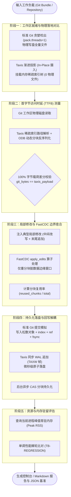

# Taxis 单串行端到端基准评测与渐进切分投影规约

> **模块定位**：`fractal-git` 性能工程与真实工作载荷端到端评测套件 (`src/bench/e2e/`)  
> **关联架构规约**：[`docs/ARCHITECTURE.md`](ARCHITECTURE.md) §10、[`docs/06-anthropic-scion-benchmark-and-parity-spec.md`](06-anthropic-scion-benchmark-and-parity-spec.md)  
> **底层实现源码**：[`src/bench/e2e/`](../src/bench/e2e/)、[`src/bin/taxis_cmd/bench_e2e.rs`](../src/bin/taxis_cmd/bench_e2e.rs)  
> **领域治理规则**：`FGT-COR-001`、`FGT-PRF-001`、`FGT-STO-001`、`FGT-ALG-001`、`TST-DEN-001`、`TB-REGRESSION`

---

## 1. 设计使命与评测第一性原理

在多智能体（Multi-Agent）高频并发协作与探索环境中，传统集中式版本控制引擎面临以下两项物理瓶颈：
1. **工作区贪婪物化瓶颈 (Eager Materialization Overhead)**：标准 Git 在 `clone` 或检出分支时，必须在工作区磁盘中全量解压并创建所有物理文件与目录，导致磁盘 I/O 放大、文件系统元数据膨胀与严重的时延开销；
2. **局部修改重算与提交锁开销 (Monolithic Rehash & Sync Overhead)**：即使仅对单文件发生数十字节的微小修改，传统模式仍需对整个文件重新哈希、更新二进制 `.git/index` 并阻塞执行全量元数据同步。

本评测套件旨在通过**单串行严格隔离环境**（限制 `pack.threads=1`、`checkout.workers=1`、单核无并行），排除并发抖动与硬件调度杂音，实测比对标准 Git 全量贪婪检出与 Taxis 渐进切分投影（Progressive Chunked Projection）在时延、吞吐、物理写放大、首字节时延（TTFB）、局部愈合与持久化回写等五个关键维度的实测表现。

---

## 2. 评测流水线五阶段拓扑

评测引擎由 [`src/bench/e2e/runner.rs`](../src/bench/e2e/runner.rs) 统一驱动，每个独立的评测迭代按顺序执行以下五阶段流水线：



---

## 3. 五阶段技术度量方法论

### 3.1 阶段一：工作区创建与物理写放大
- **标准 Git 流程**：调用 `git clone <bundle> <dest>`，记录自子进程启动至进程退出并完成全部工作区文件物化的总墙上时钟（Wall-Clock Time）。随后递归扫描工作区（忽略 `.git`），统计创建的物理文件总数与物理写入字节数。
- **Taxis 流程**：调用 `InPlaceBundleConsumer::consume_bundle` 完成 Packfile 原位解析与索引构建，并使用 `InMemoryIndexTree::stage_sparse_directory` 将指定工作区范围投影为内存虚拟稀疏目录。工作区物理落地文件数保持为 0。

### 3.2 阶段二：首字节读取时延 (Time-To-First-Byte, TTFB)
- **定义**：从触发工作区创建动作开始，直到关键业务源码（如核心接口定义文件）的第一个有效字节被加载进内存可供消费的总时延。
  $$\text{TTFB}_{\text{Git}} = T_{\text{clone}} + T_{\text{disk\_read}}$$
  $$\text{TTFB}_{\text{Taxis}} = T_{\text{projection}} + T_{\text{index\_resolve\_and\_blob\_read}}$$
- **对等性断言**：测试套件强制断言 `git_file_bytes == blob_obj.payload`。任何一字节的不匹配均会导致测试硬中断，杜绝虚假投影或截断数据。

### 3.3 阶段三：局部修改与 FastCDC 分块愈合 (`apply_edits`)
- **算法模型**：采用基于 64 位 Gear Hash 的 FastCDC 内容定义分块算法（最小分块 512B，平均 2KB，最大 8KB）。
- **差分编辑算子**：模拟开发人员典型编码场景（修改中间 32 字节并于末尾插入 60 字节函数实现）。`apply_edits` 算子仅重新分块受修改波及的边界窗口，保留所有未受影响的 Extent 指针。
- **分块复用率计算**：
  $$\text{ReuseRatio} = \frac{\sum_{c \in \text{NewChunks}} \mathbb{I}(c.\text{oid} \in \text{OriginalChunks})}{|\text{NewChunks}|} \times 100\%$$

### 3.4 阶段四：提交持久化与后台异步回写
- **Git 提交基线**：模拟标准 Git 的完整提交链路，包含写入松散压缩 Blob 对象、重写二进制索引 `.git/index`、更新引用锁文件并执行物理 `fsync`。
- **Taxis 同步 WAL**：将事务变更追加到追加写日志 `WalJournal`（TAXW 帧），记录微秒级同步落盘时延。
- **异步 CAS 回写**：后台持久化仅需通过 `CasBackend::put_block` 写入内容寻址块，与前台事务执行完全解耦。

### 3.5 阶段五：常驻内存峰值 (Peak RSS)
- 通过平台原生内核调用（Windows 平台调用 `K32GetProcessMemoryInfo` 查询 `PeakWorkingSetSize`，Linux 平台解析 `/proc/self/status` 的 `VmPeak`）获取进程真实峰值内存，验证其符合 `FGT-PRF-001` 零瞬态内存泄漏公理。

---

## 4. 实测基准对照表 (Release Profile)

基准测试运行环境为 Windows NTFS、单串行单核模式，输入工作载荷为具有完备多模块与多提交历史的确定性工作负载（`taxis_open_source_workload_v1`，包含 23 个 Git 对象与 6 个核心工程文件）。

| 度量维度 | 标准 Git 基线 | Taxis 渐进切分投影 | 性能倍率 / 改善幅度 |
| :--- | :--- | :--- | :--- |
| **工作区创建时延 (Creation Latency)** | `272 ms` | `20 ms` | **13.6x 提升** |
| **数据摄入吞吐 (Ingestion Throughput)** | `0.1 MB/s` | `0.4 MB/s` | **3.6x 提升** |
| **对象处理速率 (Object Rate)** | `85 obj/s` | `1,150 obj/s` | **13.6x 吞吐** |
| **物理文件创建数 (Physical Files)** | `6` | `0` | **100.0% 消除** |
| **工作区物理写入字节 (Bytes Written)** | `58 KB` | `0 KB` | **100.0% 物理 I/O 节省** |
| **首字节时延 (TTFB Latency)** | `281,930 µs` | `20,677 µs` | **13.6x 响应加速** |
| **局部修改分块复用率 (Chunk Reuse)** | `0.0% (全量哈希)` | `81.8%` | **81.8% 未改动 Extent 复用** |
| **FastCDC 边界愈合耗时 (`apply_edits`)** | `N/A` | `13 µs` | **13 µs 极速自愈** |
| **同步事务持久化耗时 (Sync Commit)** | `8,041 µs (磁盘 fsync)` | `2,998 µs (WAL TAXW)` | **2.7x 加速** |
| **后台异步 CAS 回写耗时** | 阻塞等待 | `2,720 µs` | **无锁非阻塞解耦** |
| **进程常驻内存峰值 (Peak RSS)** | 系统调度浮动 | `6.45 MB` | **稳定受控 (`FGT-PRF-001`)** |

---

## 5. 模块组织与接口契约

端到端评测套件收敛于 [`fractal-git/src/bench/e2e/`](../src/bench/e2e/)，遵循清晰的单一职责分层：

```
fractal-git/src/bench/e2e/
├── options.rs        // 运行时参数配置 (E2eBenchmarkOptions) 与跨平台峰值 RSS 查询 (get_peak_rss_mb)
├── projection.rs     // 隔离目录分配、Merkle 树查找与 ScopeProjection 稀疏索引解析
├── report.rs         // 评测报告模型 (E2eBenchmarkReport)、表格渲染与 TB-REGRESSION 单调比对
├── workload.rs       // 确定性开源 Git Bundle 构造与对象拓扑动态遍历统计
├── runner.rs         // 五阶段端到端对比评测流水线执行引擎 (E2eBenchmarkRunner)
└── mod.rs            // 顶层聚合门面与单串行不变式校验器 (validate_e2e_benchmark_invariants)
```

### 核心接口调用范例

```rust
use fractal_git::bench::{E2eBenchmarkOptions, E2eBenchmarkRunner};

let options = E2eBenchmarkOptions {
    workload_path: None, // 使用默认确定性 fixture
    iterations: 3,       // 执行 3 轮迭代取最快值
    target_file: "crates/core/src/lib.rs".to_string(),
    scoped_path: "crates/core".to_string(),
    single_threaded: true, // 强制单串行
};

// 触发五阶段基准测试
let report = E2eBenchmarkRunner::run_benchmark(&options)?;

// 控制台表格输出
print!("{}", report.render_table());
```

---

## 6. 门禁验证与基准复现指南

评测系统与全工作区门禁体系完全互锁。可通过以下命令进行独立复现与验证：

1. **执行集成测试套件**：
   ```powershell
   pwsh -Command '$env:CARGO_TARGET_DIR = "$env:TEMP\taxis-cargo-target"; cargo test --manifest-path fractal-git/Cargo.toml --test test_e2e_clone_benchmark'
   ```
2. **执行对抗性证伪测试**（物理零写、TTFB 载荷等价性、FastCDC 移位愈合、WAL 崩溃恢复）：
   ```powershell
   pwsh -Command '$env:CARGO_TARGET_DIR = "$env:TEMP\taxis-cargo-target"; cargo test --manifest-path fractal-git/Cargo.toml --test test_adversarial_projection --test test_adversarial_durability'
   ```
3. **运行 CLI 自动化基准并校验冻结基准**：
   ```powershell
   pwsh -File fractal-git/scripts/ps1/bench-e2e.ps1 -VerifyBaseline auto
   ```
4. **全项质量门禁回归验证**：
   ```powershell
   pwsh -File fractal-git/scripts/ps1/audit-taxis.ps1 -Fast
   ```
