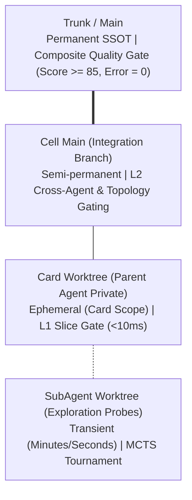
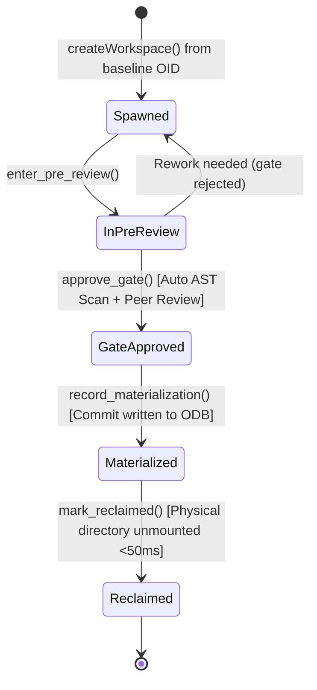

# Fractal Git Architecture Specification

> **Subsystem**: Fractal Git (`fractal-git/`)  
> **Target Role**: Core Versioning & Concurrent Spatial Time-Machine for Agent-Native Systems  
> **Source Pointer**: [`docs/agent-native-system-blueprint.md`](../../docs/agent-native-system-blueprint.md) §4.2~§4.3  
> **Detailed Docs Index**: [`docs/README.md`](README.md)

---

## 1. Topological Hierarchy & Promotion Gates



### Promotion & Reclamation Axioms:
1. **Isolation Axiom**: `SubAgent` can only merge into its direct parent `Card` worktree; direct promotion to `CellMain` or `Trunk` triggers `TopologyBreach`.
2. **Two Human Gates**:
   - `CellMain`: Tactical domain integration overseen by domain leaders via Dual-Faced task summaries;
   - `Trunk`: Strategic production release overseen by system architects via architectural impact matrices.
3. **On-Demand Reclamation**: Upon merging upstream, temporary directories are physically unmounted and pruned within `<50ms`, while Git commit DAG objects remain permanently indexed in `.git/objects/`.

---

## 2. Lockless In-Memory Virtual Index

Traditional Git serializes concurrent access via `.git/index.lock`. Fractal Git eliminates this bottleneck by assigning each agent an isolated `InMemoryTreeBuilder`.
Staged entries are maintained in memory and written directly as loose objects (`blob` and `tree`), achieving **0% file lock contention** and `<3ms` commit assembly.

---

## 3. Worktree Deterministic Lifecycle State Machine



---

## 4. Dual-Faced Commit Data Layout

```
+------------------------------------------------------------------+
| tree <40-char-sha1>                                              |
| parent <40-char-sha1>                                            |
| author <agent_uid> <<agent_uid>@<cell_id>.praxis.local> <ts> +0000|
| committer <agent_uid> <<agent_uid>@<cell_id>.praxis.local> <ts>   |
|                                                                  |
| feat(core): atomic task implementation                           |
|                                                                  |
| [Project: fractal-git]                                           |
| [Why] Resolves domain requirement card-101                       |
| [Changed] Added AST-verified parsing logic                       |
| [Verification] Verified AST invariant assertion with zero cycle  |
|                                                                  |
| Praxis-Agent-Meta: {"card_id":"...","score":100.0,...}           |
+------------------------------------------------------------------+
```
