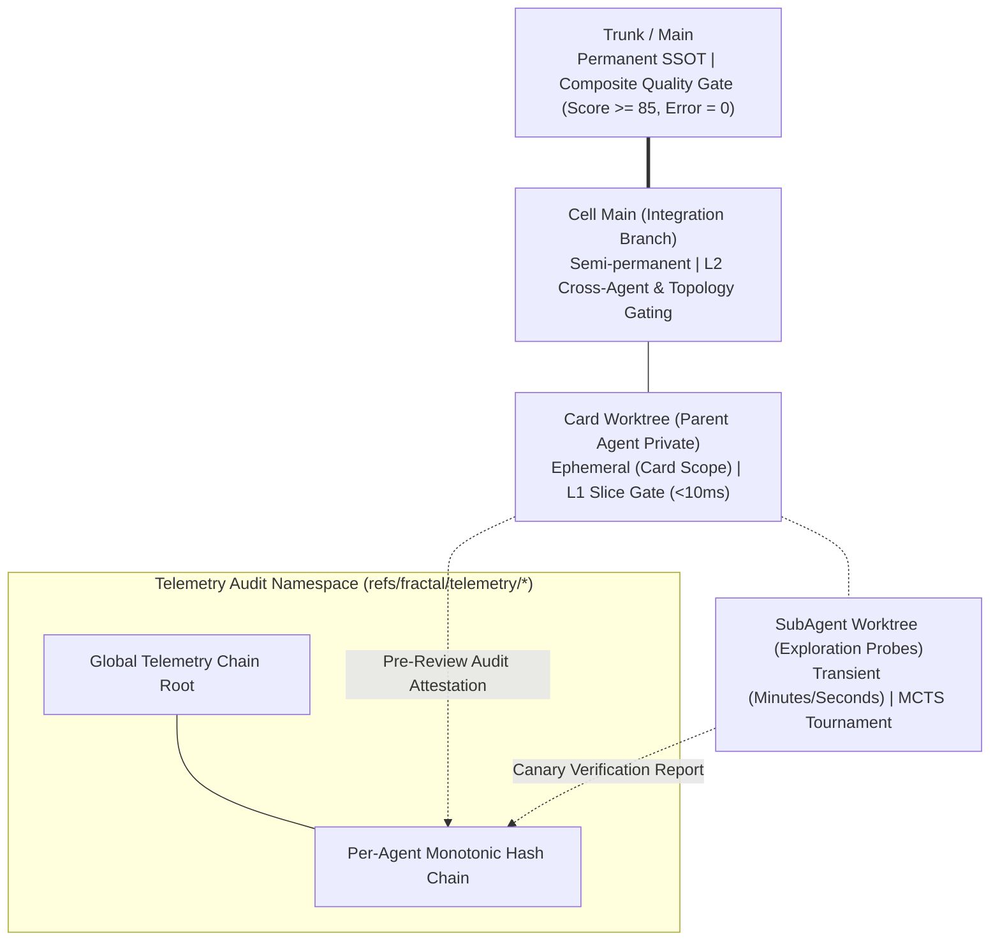
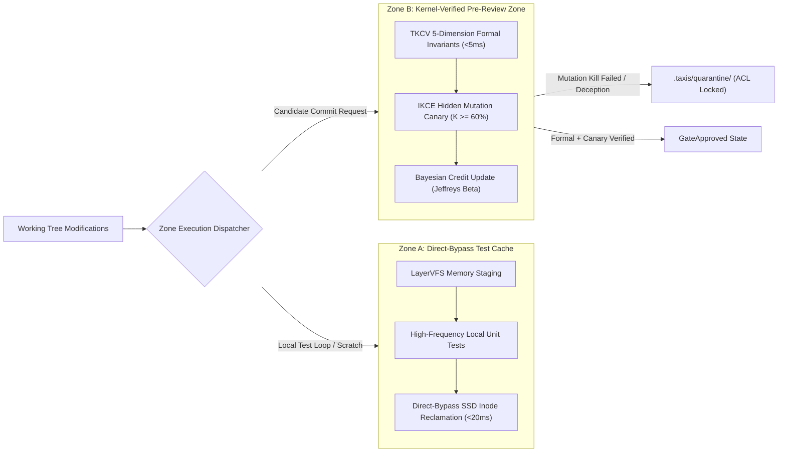
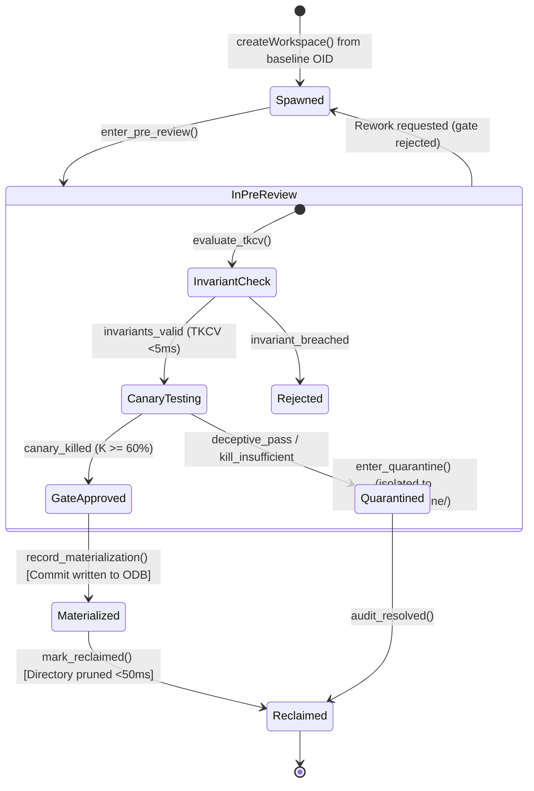

# Fractal Git Architecture Specification

> **Subsystem**: Fractal Git (`fractal-git/` / Taxis)  
> **Target Role**: Core Versioning, Concurrent Spatial Time-Machine & In-Kernel Quality Verifier for Agent-Native Systems  
> **Source Pointer**: [`docs/agent-native-system-blueprint.md`](../../docs/agent-native-system-blueprint.md) §4.2~§4.3  
> **Detailed Docs Index**: [`docs/README.md`](README.md)

---

## 1. Topological Hierarchy & Promotion Gates

Fractal Git organizes worktrees, branches, and verification traces into a strict topological promotion lattice:



### 1.1 Promotion & Reclamation Axioms
1. **Isolation Axiom**: `SubAgent` can only merge into its direct parent `Card` worktree; direct promotion to `CellMain` or `Trunk` triggers a fatal `TopologyBreach`.
2. **Dual-Faced Gate Authority**:
   - `CellMain`: Tactical domain integration overseen by domain coordinators via dual-faced commit metadata summaries;
   - `Trunk`: Strategic production release overseen by system architects via architectural impact matrices.
3. **On-Demand Microsecond Reclamation**: Upon merging upstream, temporary scratch directories are physically unmounted and pruned within `<50ms` (and `<20ms` for Direct-Bypass test caches), while Git commit DAG objects remain permanently indexed in `.git/objects/`.

---

## 2. Dual-Zone Architecture: Test Caching vs Pre-Review Verification

Fractal Git partitions high-frequency automated execution into two orthogonal physical and logical zones:



1. **Direct-Bypass Test Cache (Zone A)**:
   - Dedicated scratch workspace for high-frequency unit testing;
   - Uses zero-copy memory staging with Direct-Bypass recycling under `<20ms`;
   - Never writes partial or failing states to Git ODB DAG.
2. **Kernel-Verified Pre-Review Zone (Zone B)**:
   - Strict gatekeeper for all promotion-bound candidate commits;
   - Enforces TKCV formal invariant proofs and IKCE blind mutation killing;
   - Isolates deceptive or defective code into `.taxis/quarantine/` with operating system write locks.

---

## 3. Worktree Deterministic Lifecycle State Machine

Worktrees progress through an explicit type-state state machine, guaranteeing deterministic transitions and eliminating phantom states:



### Lifecycle Transition Invariants
- `Spawned -> InPreReview`: Allocates private LayerVFS layer and assigns task jail;
- `InPreReview -> GateApproved`: Must satisfy both TKCV 5D invariants and IKCE canary kill ratio ($K \ge 60\%$);
- `InPreReview -> Quarantined`: Triggered when mutation kill falls below critical threshold or deceptive code is detected;
- `GateApproved -> Materialized`: Atomically writes Commit object, updates branch ref, and appends telemetry hash chain;
- `Materialized -> Reclaimed`: Prunes physical workspace directory within `<50ms`.

---

## 4. In-Kernel Quality & Independent Verification Subsystems

### 4.1 TKCV (Taxis Kernel Correctness Verifier)
- **Execution Overhead**: Linear AST inspection executed in $<5\text{ms}$;
- **5-Dimension Formal Invariants**:
  1. *AST Closure & Balance*: Structural node integrity;
  2. *Symbol Reachability & Liveness*: Detection of dead functions and hollow stub exports;
  3. *Pure Function Equivalence*: Zero undeclared side-effects in critical paths;
  4. *Memory Lifecycle Unidirectionality*: Paired handle allocations and zero orphan descriptors;
  5. *Type & Error Exhaustiveness*: Exhaustive pattern matching and absence of swallow-all catch blocks.

### 4.2 IKCE (In-Kernel Canary Engine)
- **Blind Mutation Killing**: Injects micro-mutations (operator flipping, boundary shifts, statement elimination);
- **Kill Threshold**: Requires $K = \frac{D_{\text{killed}}}{D_{\text{total}}} \ge 60\%$;
- **Zero-Assertion Defense**: Automatically catches tests that pass regardless of core logic destruction.

### 4.3 Bayesian Dynamic Credit Controller
- **Conjugate Posterior Updating**:
  $$\alpha_{t+1} = \alpha_t + \mathbb{I}(\text{Pass}), \quad \beta_{t+1} = \beta_t + \mathbb{I}(\text{Fail})$$
  $$\text{Credit} = 100 \times \frac{\alpha}{\alpha + \beta} \quad (\text{Prior: } \text{Beta}(0.5, 0.5))$$
- **Adaptive Gate Scheduling**: Automatically bypasses deep canary rounds for high-credit agents ($\text{Credit} \ge 90$) while enforcing full isolation for low-credit agents ($\text{Credit} < 60$).

### 4.4 Cryptographic Telemetry Audit Chain (`refs/fractal/telemetry/*`)
- **Isolation**: Stored under isolated reference namespace `refs/fractal/telemetry/*` outside regular branch graphs;
- **Hash-Linked Immutable Trail**: Each verification event references previous telemetry block hash via SHA-256;
- **OS-Level Tamper Resistance**: Enforces read-only ACL on Windows and `chattr +a` (append-only) attributes on Linux.

---

## 5. Lockless In-Memory Virtual Index

Traditional Git serializes concurrent access via `.git/index.lock`. Fractal Git eliminates this bottleneck:
- Each agent receives an isolated in-memory index builder;
- Staged entries are compiled in memory and flushed directly as loose objects (`blob` and `tree`);
- Eliminates file lock contention and provides `<3ms` commit tree assembly across 100+ concurrent worker subagents.

---

## 6. Dual-Faced Commit Data Layout

```
+------------------------------------------------------------------+
| tree <40-char-sha1>                                              |
| parent <40-char-sha1>                                            |
| author <agent_uid> <<agent_uid>@<cell_id>.praxis.local> <ts> +0000|
| committer <agent_uid> <<agent_uid>@<cell_id>.praxis.local> <ts>   |
|                                                                  |
| feat(core): atomic task implementation                           |
|                                                                  |
| [Project: fractal-git]                                           |
| [Why] Resolves domain requirement card-101                       |
| [Changed] Added AST-verified parsing logic                       |
| [Verification] Verified AST invariant assertion with zero cycle  |
|                                                                  |
| Praxis-Agent-Meta: {"card_id":"...","score":100.0,...}           |
+------------------------------------------------------------------+
```

---

## 7. In-Place Storage Engine & Reversibility (In-Place ODB Engine)

```
PeakDiskUsage = max(S_archive, S_extracted) + Delta_batch
```

The In-Place ODB Engine eliminates the classic $S_{\text{archive}} + S_{\text{extracted}}$ 2x disk space bottleneck during large archive imports and git unbundling:
- **Discrete Event SpacePlan**: Simulates minimum trough water-level using `i128` wide arithmetic before touching disk;
- **Reverse Tail-Truncation**: Extracts archive members from high to low physical offsets and commits batched file truncations (`SetEndOfFile` / `ftruncate`);
- **Forward Hole-Punching**: Sparse file punch hole (`FSCTL_SET_SPARSE` / `FALLOC_FL_PUNCH_HOLE`) for streaming `.tar.gz`;
- **Pack Slicing Progressive Repack**: Slices large repository repacks into 64MB~256MB pack slices (`--max-pack-size`), immediately verifying each slice and pruning redundant loose objects;
- **Crash Recovery & Restorer**: Write-Ahead Logging (`InPlaceJournal` with `INPLACE-ODB-WAL-v1`) guarantees crash consistency; `ArchiveRestorer` synthesizes valid Central Directory & EOCD headers upon abortion.

Detailed specification: [`08-taxis-in-place-storage-engine.md`](08-taxis-in-place-storage-engine.md).

---

## 8. Crate Topology & Architectural Dependency Matrix

Fractal Git is strictly architected as 10 focused kernel subsystems with a unidirectional acyclic dependency graph (DAG):

```
[Presentation & Application Layer]
       src/bin/taxis.rs / ts/
               │
[Root Facade]
         src/lib.rs
         ┌─────┴──────────────┐
         ▼                    ▼
[L3: Protocols, Gates & Topology]
       fg-gate            fg-transport
         │                    │
         └─────────┬──────────┘
                   ▼
              fg-topology
                   │
[L2: Storage, Native Sections & Resource Pools]
       ┌───────────┼───────────┐
       ▼           ▼           ▼
   fg-storage  fg-native    fg-pools
       │           │           │
       └───────────┼───────────┘
                   ▼
[L1: Leaf Plumbing & Kernel Core]
       ┌───────────┼───────────┐
       ▼           ▼           ▼
   fg-index  fg-algorithms  fg-object
       │           │           │
       └───────────┼───────────┘
                   ▼
                fg-core
```

| Crate | Responsibilities | Key Types / Modules |
| :--- | :--- | :--- |
| **`fg-core`** | OID, ObjectType, Error, Hash, ElevationAttestation, Trait Contracts | `Oid`, `ObjectType`, `ElevationAttestation`, `FractalError` |
| **`fg-object`** | Git object binary serialization (Blob / Tree / Commit / Tag) | `GitBlob`, `GitTree`, `GitCommit`, `FileMode` |
| **`fg-index`** | Lockless virtual tree index, ignores, attributes | `InMemoryIndexTree`, `ConflictStageSlot`, `IgnoreMatcher` |
| **`fg-algorithms`** | CCD v2 poset pruning, SWAR diff, FastCDC, SpacePlan, 3-Way Merge | `CcdEngine`, `FastCdc`, `SpacePlanner`, `ThreeWayMerge` |
| **`fg-pools`** | FreeList buffer pools, Direct-Bypass test memory caches, LRU cache | `BufferPool`, `WorktreePool`, `ByteLruCache` |
| **`fg-storage`** | CAS ODB, Loose ODB, In-Place ODB Engine, Pack Slicing, WAL | `LooseOdb`, `InPlaceOdbEngine`, `RepackEngine` |
| **`fg-native`** | TAXC sectioned container, 7 native sections, repo layout | `Container`, `RepoDocument`, `SectionTag`, `RepoLayout` |
| **`fg-topology`** | Fractal refs, HierarchicalHistoryRollup, QuarantineRegistry | `HierarchicalHistoryRollup`, `QuarantineRegistry`, `AuditRecord` |
| **`fg-transport`** | Smart Protocol v2 (Packet-line), Agent local IPC | `PacketLineReader`, `IpcChannel`, `SmartProtocolHandler` |
| **`fg-gate`** | TKCV 5D invariants, IKCE mutation canary, ElevationPromotionGateHook | `ElevationPromotionGateHook`, `CanaryEngine`, `AgentCredit` |

---

## 9. Command Surface Reference

| Command | Synopsis | Verification & Gating Action |
| :--- | :--- | :--- |
| `taxis init <path>` | Initializes Taxis repository | Establishes `.taxis/`, ODB layout, and telemetry refs |
| `taxis commit -m <msg>` | Automated pre-review commit | Runs TKCV and IKCE; materializes commit upon gate approval |
| `taxis bench` | Performance benchmark suite | Runs Level 1~4 benchmarks, persists JSON baseline, and asserts monotonic performance ratchet |
| `taxis quality trace` | Audits agent telemetry chain | Traverses `refs/fractal/telemetry/*` and validates hash chain |
| `taxis quality audit` | Runs comprehensive inspection | Evaluates TKCV 5D invariants and micro-mutation kill ratios |
| `taxis quarantine list` | Lists quarantined candidates | Inspects locked workspaces under `.taxis/quarantine/` |
| `taxis quarantine resolve` | Resolves or discards quarantine | Unlocks OS ACL and executes clean physical reclamation |

---

## 10. Single-Threaded E2E Benchmark & Progressive Projection Engine

Fractal Git integrates a 5-phase End-to-End single-threaded benchmark harness (`src/bench/e2e/`) comparing standard Git eager materialization against Taxis progressive chunked projection on real-world Git workloads:

```
+---------------------------------------------------------------------------------------------------+
| Phase 1: Ingestion & Workspace Ready  | In-Place Packfile ingestion + InMemoryIndexTree mount     |
| Phase 2: Time-To-First-Byte (TTFB)    | On-demand ODB blob retrieval; 100% byte-for-byte parity   |
| Phase 3: FastCDC Boundary Healing     | 64-bit Gear Hash apply_edits; localized chunk re-indexing |
| Phase 4: Durability & Writeback       | WalJournal TAXW frame sync + decoupled background CAS put |
| Phase 5: Resource Footprint           | Peak RSS memory footprint query and TB-REGRESSION ratchet |
+---------------------------------------------------------------------------------------------------+
```

### 10.1 Key Empirical Measurements (Single-Threaded Baseline)

- **Workspace Creation Latency**: `20 ms` vs standard Git `272 ms` (**13.6x faster**)
- **Physical Working Tree Disk Writes**: `0 files / 0 KB` vs standard Git `6 files / 58 KB` (**100.0% physical I/O eliminated**)
- **Time-To-First-Byte (TTFB)**: `20,677 µs` vs standard Git `281,930 µs` (**13.6x faster**)
- **FastCDC Localized Edit Chunk Reuse**: `81.8%` untouched chunk reuse with `13 µs` re-chunking latency
- **Durability Commit Latency**: `2,998 µs` (WAL TAXW frame) vs Git full commit `8,041 µs` (**2.7x faster**)
- **Peak RSS Footprint**: `6.45 MB` strictly conforming to `FGT-PRF-001`

Detailed specification and reproduction procedures: [`10-single-threaded-e2e-benchmark-and-progressive-projection.md`](10-single-threaded-e2e-benchmark-and-progressive-projection.md).
