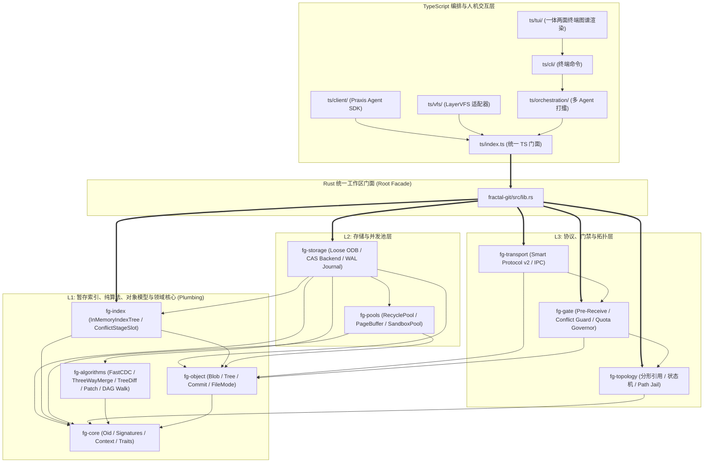

# Fractal Git 目录职责规范与全域扩展指引 (Directory Specification)

> **模块定位**：`fractal-git` 全域物理微 Crate 与上层编排物理目录职责总规与单向依赖指针  
> **设计架构**：深度对标 GitHub 官方 `gitoxide (gix-*)` Micro-Crates 架构与 Agent 原生无锁设计  
> **设计原则**：严格高内聚、零循环依赖、明确单一职责、算法/池/索引正交解耦、纯接口抽象与策略物理隔离

---

## 1. 工业级微 Crate 与子系统矩阵 (Subsystem Matrix)

| 目录路径 | 角色定位 | 核心职责与设计边界 | 允许依赖 | 严禁反向依赖 |
| :--- | :---: | :--- | :--- | :--- |
| **`crates/fg-core/`** | 领域核心基石 | 纯原子数据模型（`Oid`, `GitSignature`, `PraxisCardContext`, `AgentCommitMeta`）与核心抽象 Trait（`OdbStore`, `RefStore`, `GateVerifier`, `WorktreeReclaimer`）。零业务依赖。 | 基础错误与序列化库 | 严禁依赖任何具体存储、算法或上层 Crate |
| **`crates/fg-object/`** | Git 原生对象模型 | 纯 Git 对象编解码（`GitBlob`, `GitTree`, `GitCommit`, `FileMode`）与规范二进制排序（目录尾斜杠规则）。纯数学与数据算子。 | `fg-core`, `sha1`, `flate2` | 严禁依赖拓扑、网络、存储引擎或进程调用 |
| **`crates/fg-index/`** | 暂存区与无锁虚拟树 | 彻底消融 `.git/index.lock` 的无锁内存暂存区索引（`InMemoryIndexTree`）、规范四阶段冲突槽（`Stage 0..3`、`ConflictStageSlot`）与目录树生成回调。 | `fg-core`, `fg-object` | 严禁依赖底层物理 I/O、网络传输或业务调度 |
| **`crates/fg-algorithms/`** | 纯算法与数学算子库 | 对标 `git/xdiff`：FastCDC 变长分块滚动哈希、三方合并（`ThreeWayMerge`，快进检测与冲突判定）、内存树差分（`TreeDiff`）、Unified Diff 补丁生成（`PatchGenerator`）、DAG 拓扑排序与祖先可达性剪枝（`DagWalker`）。 | `fg-core`, `sha1` | 严禁包含物理文件读写或业务状态 |
| **`crates/fg-pools/`** | 资源池与分配管控 | 纯粹践行 `ADV-PRF-002` 循环内零堆分配：树节点与 AST 对象复用池（`RecyclePool`）、64KB 压缩页面缓冲池（`PageBufferPool`）、预热虚拟工作区沙箱槽位池（`SandboxPool`, `WorktreePool`）。 | `fg-core`, `fg-object`, `parking_lot` | 严禁侵入策略守卫、业务调度或传输协议 |
| **`crates/fg-storage/`** | 真实不可变存储底座 | 松散对象存储（`LooseOdb` 原子写入 `.git/objects/`）、不可变 CAS 块后端（`CasBackend`）、崩溃安全事务预写日志（`WalJournal`）、LayerVFS 快照向 Git 对象的原子物化器（`CasToGitMaterializer`）。 | `fg-core`, `fg-object`, `fg-index`, `fg-algorithms` | 严禁依赖传输层协议或 CLI 交互 |
| **`crates/fg-topology/`** | 自相似分形拓扑 | 自相似四层引用系统（`refs/fractal/{dept}/{cell}/{card}/{agent}`）、合并合法性断言器（`TopologyVerifier`，严守 SubAgent 仅合入父级 Card 铁律）、工作树生命周期状态机（`WorktreeStateMachine`）、以及 Path Jail 沙箱隔离契约（`FractalWorktree`, `PathJail`）。 | `fg-core`, `serde`, `chrono` | 严禁直接依赖物理存储或对象编码实现 |
| **`crates/fg-transport/`** | 自托管传输协议栈 | 内部 Agent 零拷贝本地 IPC（`IpcMessage`, `IpcCodec` 4 字节帧协议）与标准 Git Smart Protocol v2（`PacketLine` 4 字节 Hex 流式编解码、`ls-refs`, `fetch` 协商）。 | `fg-core`, `fg-object`, `fg-topology` | 严禁侵入存储物理层与代码审查逻辑 |
| **`crates/fg-gate/`** | 预审门禁与风控守卫 | 协议层门禁拦截：`PreReceiveGuard` 身份与分支越权拦截（禁止直接推入 Trunk、禁止 `--force` 强推）、微秒级物理卫生与冲突标记守卫（`ConflictGuard` 扫描 `<<<<<<<`, `=======`）、以及从 pools 剥离并归位的并发工作树与磁盘配额守卫（`QuotaGovernor`）。 | `fg-core`, `fg-object`, `fg-topology` | 严禁依赖传输层实现细节或物理存储底层 |
| **`src/lib.rs` (根)** | 统一门面 (Facade) | 工作区根 Rust 门面（`ARCH-FAC-001`），统摄并平铺导出全量 9 个微 Crate，提供高人机工学的一站式 SDK 接口。 | 全量 `crates/fg-*` | — |
| **`ts/`** | TypeScript 编排与客户端 | 工业化五层分工：`client/` (Praxis Agent SDK 客户端)、`vfs/` (LayerVFS 虚拟文件系统适配器)、`tui/` (一体两面终端渲染器)、`orchestration/` (多 Agent 打擂提拔器)、`cli/` (终端命令)。 | 顶层契约与原生桥 | 严禁在门面外泄露低级指针 |
| **`scripts/`** | 工程构建与自测脚本 | 跨平台工程构建（`build.ps1` CRLF / `build.sh` LF `set -euo pipefail`）、自测流水线与门禁检查脚本。 | 外部编译器工具链 | 严禁硬编码绝对路径或 Windows 盘符 |
| **`tests/`** | 双轨集成与基准测试 | Rust 7 大微 Crate 集成测试套件（`tests/rust/`）与 TypeScript 仿真测试（`tests/ts/`）。 | 被测项目各模块 | 严禁生产代码反向依赖测试夹具 |

---

## 2. 单向依赖拓扑流向图 (Micro-Crates Dependency Flow)

系统内部严格执行**单向无环依赖（DAG）**，底层为纯模型、纯算法与纯索引，中层为物理池与存储，顶层为拓扑与传输，门面层为 TypeScript 编排：

---

## 3. 后续扩展放置规范 (Extension & Contribution Guide)

为了防止未来代码库膨胀与碎片化，任何新增功能必须按照以下路由矩阵严格归位：

### 3.1 场景 A：新增算法算子（如 Myers Diff, 语义 AST 级冲突合并, 帕累托图谱）
- **归属位置**：`crates/fg-algorithms/src/<category>/<algorithm_name>.rs`
- **契约要求**：必须为纯数学无状态函数，输入为只读切片或结构化引用，严禁包含任何文件系统 I/O 或全局锁。

### 3.2 场景 B：新增内存索引策略（如 冲突自动暂存, 目录压缩树）
- **归属位置**：`crates/fg-index/src/<strategy_name>.rs`
- **契约要求**：必须保持无锁可变性，在内存中维护纯数据结构，通过回调输出给存储层，严禁耦合直接文件读写。

### 3.3 场景 C：新增高并发缓存与资源池（如 Arena 分配器, 预编译 AST 缓存）
- **归属位置**：`crates/fg-pools/src/<pool_name>.rs`
- **契约要求**：必须实现 `Resettable` 特征，提供 `acquire()` 与 `release()` 方法，确保高频循环中瞬态堆分配归零（`ADV-PRF-002`）。严禁塞入策略性配额代码。

### 3.4 场景 D：新增存储底座（如 Packfile 索引读取, SQLite WAL 归档, S3 镜像）
- **归属位置**：`crates/fg-storage/src/backends/<backend_name>.rs`
- **契约要求**：必须实现 `fg-core::traits::OdbStore` 抽象 Trait，支持 `read_object`、`write_object` 与 `has_object`。

### 3.5 场景 E：新增自托管通信协议（如 WebSockets / gRPC / WebDAV）
- **归属位置**：`crates/fg-transport/src/<protocol_name>.rs`
- **契约要求**：必须通过 `crates/fg-gate/src/pre_receive.rs` 进行身份认证与权限校验，严禁绕过门禁直接修改引用。

### 3.6 场景 F：新增安全策略与配额风控（如 内存配额, 网络频控）
- **归属位置**：`crates/fg-gate/src/<governor_name>.rs`
- **契约要求**：必须集中在 `fg-gate`，严禁与 `fg-pools` 混淆。
